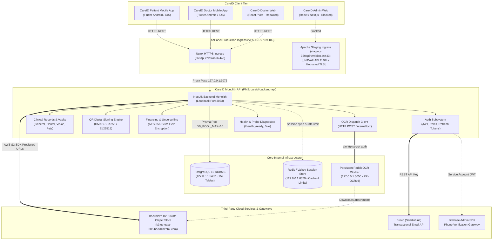

# CAREID — SERVICE DEPENDENCY AND TOPOLOGY MAP

**Product:** CareID Clinical Network  
**Verification Date:** November 10, 2026  
**Auditor:** Antigravity Autonomous Systems Engineering Team  
**Scope:** Complete End-to-End Architectural Topology, Service Mappings, Cascade Failure Analysis & Degraded Mode Resilience

---

## 1. System Architecture & Topology Diagram

---

## 2. Comprehensive Service Dependency Matrix

| ID | Source Component | Target Dependency | Protocol / Port | Criticality | Cascade Failure Impact | Automatic Fallback / Resilience Behavior |
| :---: | :--- | :--- | :--- | :---: | :--- | :--- |
| **DEP-01** | Client Apps (Patient/Doctor) | aaPanel Nginx Ingress | HTTPS / 443 | **CRITICAL** | Zero connectivity to backend; apps enter network error state. | Clients show offline banner; local Keystore cached sessions preserved; offline QR pass displayed. |
| **DEP-02** | aaPanel Nginx Ingress | NestJS Backend (`main.js`) | HTTP / 3073 | **CRITICAL** | Ingress returns HTTP 502 Bad Gateway. | PM2 auto-restart triggers within 3000ms (`autorestart: true`). |
| **DEP-03** | NestJS Backend API | PostgreSQL Database | TCP / 5432 | **CRITICAL** | All data queries and mutations fail; `/ready` probe returns HTTP 503. | Backend returns HTTP 503 Service Unavailable; clients display actionable retry without fabricating clinical data. |
| **DEP-04** | NestJS Backend API | Redis / Valkey Cache | TCP / 6379 | **MEDIUM** | Distributed session caching and sliding-window rate limiting disabled. | Graceful in-memory cache fallback; session validation falls back to PostgreSQL token lookup. Zero user disruption. |
| **DEP-05** | NestJS Backend API | PaddleOCR Worker | HTTP / 5050 | **HIGH** | Asynchronous medical document text extraction unavailable. | Document upload to B2 still succeeds; OCR job status marked `FAILED` or `REVIEW_REQUIRED`; manual data entry fallback enabled. |
| **DEP-06** | NestJS Backend API | Backblaze B2 Storage | HTTPS / 443 | **HIGH** | Clinical attachment upload/download presigned URLs fail. | Record metadata remains intact and viewable; client displays "Attachment temporarily unavailable from storage". |
| **DEP-07** | Auth Subsystem | Brevo Email Gateway | HTTPS / 443 | **HIGH** | Outbound transactional verification emails and login OTPs fail. | Staging fallback to test OTP (`ENABLE_TEST_OTP=true` with fixed OTP `123456`) or Firebase phone verification. |
| **DEP-08** | Auth Subsystem | Firebase Admin SDK | HTTPS / 443 | **HIGH** | Phone number verification tokens cannot be decrypted or verified. | Authentication fails with clear error; fallback to email OTP or test numbers for development. |
| **DEP-09** | Clinical Subsystem | QR Digital Signing Key | In-Memory Crypto | **CRITICAL** | Health card digital signatures cannot be verified by scanning doctors. | If key is missing at boot, server refuses to start (fail-fast guard). |
| **DEP-10** | Financing Subsystem | Encryption Master Key | In-Memory Crypto | **CRITICAL** | Patient PAN/income cannot be encrypted or decrypted. | Fail-fast initialization: backend throws exception during startup if key is <32 bytes. |

---

## 3. Failure Cascade Analysis by Scenario

### Scenario 1: Complete PostgreSQL Database Outage
- **Root Causes:** VPS disk full, OOM killer terminates `postgres`, connection pool exhaustion, unhandled crash.
- **Immediate Cascades:**
  - `GET /api/v1/ready` probe fails immediately with HTTP 503:
    `{"status":"unready","database":"disconnected","error":"Database connectivity probe failed"}`.
  - Every authenticated API request (`/api/v1/auth/me`, `/api/v1/medical-records`, etc.) throws 500 or 503.
- **Client App Impact:**
  - Patient App: Catches 503, displays `Unable to load records — tap to retry`.
  - Health Card QR: Displays offline stored card with prominent disclaimer: `Offline mode — Last verified [timestamp]`.
  - **Clinical Safety Enforcement:** Zero mock records or synthetic test data are ever displayed.
- **Recovery SLA:** RTO < 5 minutes, RPO < 1 hour (daily pg_dump + WAL archiving).

---

### Scenario 2: Python OCR Worker Microservice Outage
- **Root Causes:** PaddleOCR memory exhaustion (>1.2GB RSS), timeout on large 50-page PDF, process termination.
- **Immediate Cascades:**
  - NestJS `OcrWorkerClient` detects timeout (180s) or `ECONNREFUSED` on `http://127.0.0.1:5050`.
  - Database OCR job entity transitions: `status = FAILED`, `failureReason = "OCR worker unavailable"`.
- **Client App Impact:**
  - Patient & Doctor Apps: Document viewer still renders uploaded PDF/image.
  - OCR extraction status shows `Extraction Pending / Manual Review Required`.
  - Clinical workflows are **unblocked**: Doctors can manually type or dictate prescription and diagnostic details.
- **Recovery SLA:** RTO < 2 minutes (systemd/PM2 supervisor restart).

---

### Scenario 3: Backblaze B2 Object Storage Downtime
- **Root Causes:** Regional cloud outage, expired API keys, egress bandwidth caps reached.
- **Immediate Cascades:**
  - S3 SDK throws `S3ServiceException` on `PutObjectCommand` or `GetSignedUrl`.
- **Client App Impact:**
  - Text records, timelines, prescriptions, appointments remain 100% operational (stored in PostgreSQL).
  - Document attachments display placeholder: `Attachment temporarily unavailable from storage [Retry]`.
- **Recovery SLA:** RTO < 15 minutes (switch credentials or failover to secondary S3 mirror).

---

### Scenario 4: Brevo Email / SMS Gateway Outage
- **Root Causes:** Brevo rate limit exceeded, third-party network failure, account credit exhaustion.
- **Immediate Cascades:**
  - `POST /api/v1/auth/otp/send` fails with `502 Bad Gateway` from upstream provider.
- **Client App Impact:**
  - Client displays: `SMS service temporarily unavailable. Please retry in a few moments or use alternate login method.`
  - Staging environment: Automatically bypassed using authorized test numbers (`+16505550004` / `123456`).
- **Recovery SLA:** RTO < 10 minutes (failover to secondary SMS provider or Firebase Phone Auth).

