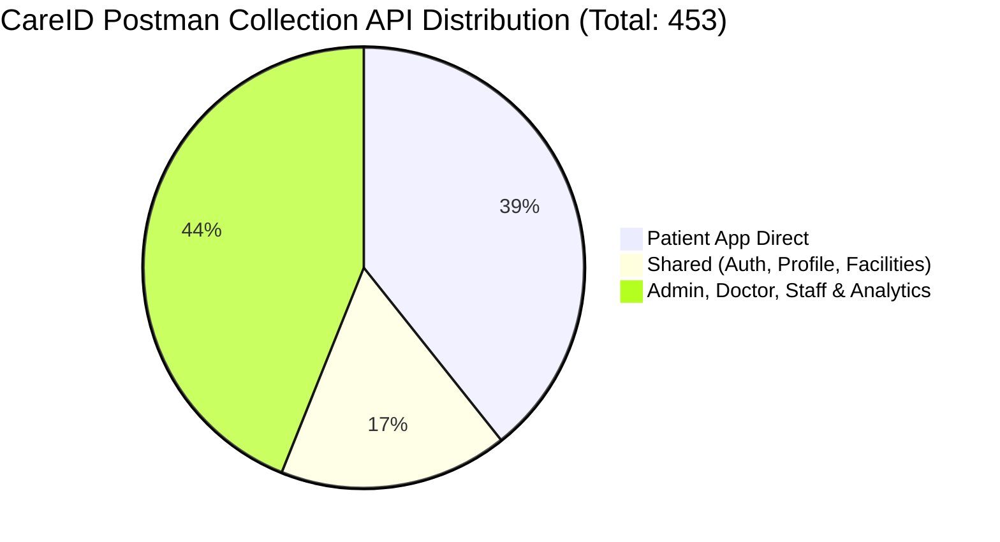

# 01. Complete Postman API Inventory — CareID Staging
**Authoritative Collection:** `CareID-Staging.postman_collection.json`  
**Base URL:** `https://360api.vnvision.in`  
**Audit Date:** October 31, 2026  

---
## 1. Executive Summary & Exact API Counts

- **Total Requests in Collection:** **453**
- **Total Unique HTTP Method + Endpoint Combinations:** **453** (0 redundant duplicates)
- **Patient App Relevant APIs (Direct):** **178**
- **Shared APIs Usable by Patient App:** **76**
- **Total Patient-Accessible APIs (Direct + Shared):** **254**
- **APIs Exclusively for Other Platforms (Doctor, Admin, Staff, Analytics, Observability):** **199**
- **Deprecated / Disabled Requests:** **0**

---
## 2. Patient App Direct Endpoints (178 Endpoints)

| Module | Endpoint | Method | Purpose | Authentication | Request Body | Response | CRUD | Postman Status |
|---|---|---|---|---|---|---|---|---|
| 06. Patient App | `/api/v1/patients/register` | `POST` | Step 1: Initialize Patient Draft Registration | Required (bearer) | `None` | JSON Object | Create / Action | Available |
| 06. Patient App | `/api/v1/patients/register/status` | `GET` | Check Draft Registration Progress Status | Required (bearer) | `None` | Standard JSON (Envelope) | Read | Available |
| 06. Patient App | `/api/v1/patients/register/resume` | `PATCH` | Resume and update registration progress | Required (bearer) | `None` | Standard JSON (Envelope) | Update | Available |
| 06. Patient App | `/api/v1/patients/onboarding/demographics` | `POST` | Step 2: Patient Demographic Registration | Required (bearer) | `{   "firstName": "John",   "lastName": "Doe",   "dateOfBi...` | JSON Object | Create / Action | Available |
| 06. Patient App | `/api/v1/patients/onboarding/demographics` | `PUT` | Step 2: Update Demographics Details | Required (bearer) | `{   "firstName": "John",   "lastName": "Doe",   "dateOfBi...` | JSON Object | Update | Available |
| 06. Patient App | `/api/v1/patients/onboarding/emergency-contact` | `POST` | Step 3: Save Emergency Contact | Required (bearer) | `{   "name": "Jane Doe",   "relationship": "Spouse",   "ph...` | JSON Object | Create / Action | Available |
| 06. Patient App | `/api/v1/patients/onboarding/emergency-contact` | `PUT` | Step 3: Update Emergency Contact | Required (bearer) | `{   "name": "Jane Doe",   "relationship": "Spouse",   "ph...` | JSON Object | Update | Available |
| 06. Patient App | `/api/v1/patients/onboarding/insurance` | `POST` | Step 4: Save Primary/Secondary Insurance Link | Required (bearer) | `{   "providerName": "Blue Shield",   "policyNumber": "POL...` | JSON Object | Create / Action | Available |
| 06. Patient App | `/api/v1/patients/onboarding/insurance` | `PUT` | Step 4: Update Insurance Details | Required (bearer) | `{   "providerName": "Blue Shield",   "policyNumber": "POL...` | JSON Object | Update | Available |
| 06. Patient App | `/api/v1/patients/onboarding/health-card` | `POST` | Step 5: Initialize Secure Digital Health Card | Required (bearer) | `None` | JSON Object | Create / Action | Available |
| 06. Patient App | `/api/v1/patients/onboarding/family-invite` | `POST` | Step 6: Family Account Linkage Request | Required (bearer) | `{   "inviteePhone": "+14155559876",   "relationship": "Ch...` | JSON Object | Create / Action | Available |
| 06. Patient App | `/api/v1/patients/onboarding/progress` | `GET` | Get Step-by-Step Onboarding Progress Checklist | Required (bearer) | `None` | JSON Object | Read | Available |
| 06. Patient App | `/api/v1/patients/onboarding/complete` | `POST` | Finalize and Complete Onboarding Registration | Required (bearer) | `None` | Standard JSON (Envelope) | Create / Action | Available |
| 06. Patient App | `/api/v1/patients/onboarding/completion` | `GET` | Get overall Patient Onboarding Completion percentage | Required (bearer) | `None` | Standard JSON (Envelope) | Read | Available |
| 06. Patient App | `/api/v1/patients/me` | `GET` | Get Patient Profile Details | Required (bearer) | `None` | JSON Object | Read | Available |
| 06. Patient App | `/api/v1/patients/me` | `PUT` | Update Patient Profile | Required (bearer) | `{   "firstName": "John",   "lastName": "Doe",   "dateOfBi...` | JSON Object | Update | Available |
| 06. Patient App | `/api/v1/patients/family-consents/:id` | `PATCH` | Accept / Reject Family Linkage Consent | Required (bearer) | `{   "status": "ACCEPTED" }` | JSON Object | Update | Available |
| 06. Patient App | `/api/v1/patients/me/full` | `GET` | Get Full Patient Profile with all extended fields | Required (bearer) | `None` | JSON Object | Read | Available |
| 06. Patient App | `/api/v1/patients/me/basic` | `PATCH` | Update Basic Patient Information (name, DOB, gender, nationality, etc.) | Required (bearer) | `{   "firstName": "John",   "lastName": "Doe",   "dateOfBi...` | JSON Object | Update | Available |
| 06. Patient App | `/api/v1/patients/me/contact` | `PATCH` | Update Contact Preferences | Required (bearer) | `{   "phone": "+923001234567",   "email": "john.doe@email....` | Standard JSON (Envelope) | Update | Available |
| 06. Patient App | `/api/v1/patients/me/address` | `PATCH` | Update Current and Permanent Address | Required (bearer) | `{   "currentAddress": {     "line1": "123 Main Street",  ...` | Standard JSON (Envelope) | Update | Available |
| 06. Patient App | `/api/v1/patients/me/preferences` | `PATCH` | Update Communication Preferences and Privacy Settings | Required (bearer) | `{   "emailNotifications": true,   "smsNotifications": tru...` | Standard JSON (Envelope) | Update | Available |
| 06. Patient App | `/api/v1/patients/me/medical-summary` | `PATCH` | Update Medical Summary (blood group, allergies, conditions, disabilities) | Required (bearer) | `{   "bloodGroup": "O+",   "knownAllergies": [     "Penici...` | Standard JSON (Envelope) | Update | Available |
| 06. Patient App | `/api/v1/patients/me/photo` | `POST` | Upload or Replace Profile Photo (provide photoUrl and photoKey) | Required (bearer) | `None` | Standard JSON (Envelope) | Create / Action | Available |
| 06. Patient App | `/api/v1/patients/me/photo` | `DELETE` | Delete Profile Photo | Required (bearer) | `None` | Standard JSON (Envelope) | Delete | Available |
| 06. Patient App | `/api/v1/patients/profile/completion` | `GET` | Get Patient Profile Completion Status with section breakdown | Required (bearer) | `None` | JSON Object | Read | Available |
| 06. Patient App | `/api/v1/patients/profile/timeline` | `GET` | Get Patient Profile Change Timeline | Required (bearer) | `None` | JSON Object | Read | Available |
| 06. Patient App | `/api/v1/patients/profile/activity` | `GET` | Get Patient Profile Activity Summary | Required (bearer) | `None` | Standard JSON (Envelope) | Read | Available |
| 07. Digital Health Cards & Passes | `/api/v1/health-cards` | `POST` | Issue a new Health Card for authenticated patient | Required (noauth) | `{   "reason": "Initial issuance during registration" }` | JSON Object | Create / Action | Available |
| 07. Digital Health Cards & Passes | `/api/v1/health-cards` | `GET` | Get active Health Card details for current patient | Required (noauth) | `None` | JSON Object | Read | Available |
| 07. Digital Health Cards & Passes | `/api/v1/health-cards/search` | `GET` | Search Health Cards by card number or patient name | Required (noauth) | `None` | JSON Array | Read | Available |
| 07. Digital Health Cards & Passes | `/api/v1/health-cards/:id` | `GET` | Get specific Health Card details by ID | Required (noauth) | `None` | JSON Object | Read | Available |
| 07. Digital Health Cards & Passes | `/api/v1/health-cards/:id` | `PUT` | Update Health Card emergency flag or metadata | Required (noauth) | `{   "emergencyFlag": true,   "metadata": "{\"notes\": \"V...` | JSON Object | Update | Available |
| 07. Digital Health Cards & Passes | `/api/v1/health-cards/:id/activate` | `POST` | Activate an ISSUED or DEACTIVATED Health Card | Required (noauth) | `{   "reason": "Action requested by patient/admin" }` | JSON Object | Create / Action | Available |
| 07. Digital Health Cards & Passes | `/api/v1/health-cards/:id/deactivate` | `POST` | Deactivate Health Card | Required (noauth) | `{   "reason": "Action requested by patient/admin" }` | JSON Object | Create / Action | Available |
| 07. Digital Health Cards & Passes | `/api/v1/health-cards/:id/suspend` | `POST` | Suspend Health Card | Required (noauth) | `{   "reason": "Action requested by patient/admin" }` | JSON Object | Create / Action | Available |
| 07. Digital Health Cards & Passes | `/api/v1/health-cards/:id/block` | `POST` | Block Health Card for security or lost card reasons | Required (noauth) | `{   "reason": "Action requested by patient/admin" }` | JSON Object | Create / Action | Available |
| 07. Digital Health Cards & Passes | `/api/v1/health-cards/:id/unblock` | `POST` | Unblock a BLOCKED Health Card | Required (noauth) | `{   "reason": "Action requested by patient/admin" }` | JSON Object | Create / Action | Available |
| 07. Digital Health Cards & Passes | `/api/v1/health-cards/:id/replace` | `POST` | Replace Health Card — generates a new card number and increments version | Required (noauth) | `{   "reason": "Action requested by patient/admin" }` | JSON Object | Create / Action | Available |
| 07. Digital Health Cards & Passes | `/api/v1/health-cards/:id/renew` | `POST` | Renew Health Card — extends validity period by 1 year | Required (noauth) | `{   "reason": "Action requested by patient/admin" }` | JSON Object | Create / Action | Available |
| 07. Digital Health Cards & Passes | `/api/v1/health-cards/:id/archive` | `POST` | Archive Health Card | Required (noauth) | `{   "reason": "Action requested by patient/admin" }` | JSON Object | Create / Action | Available |
| 07. Digital Health Cards & Passes | `/api/v1/health-cards/:id/restore` | `POST` | Restore an ARCHIVED Health Card | Required (noauth) | `{   "reason": "Action requested by patient/admin" }` | JSON Object | Create / Action | Available |
| 07. Digital Health Cards & Passes | `/api/v1/health-cards/:id/history` | `GET` | Get complete status lifecycle audit history for Health Card | Required (noauth) | `None` | JSON Array | Read | Available |
| 07. Digital Health Cards & Passes | `/api/v1/health-cards/verify-qr` | `POST` | Verify digital Health Card QR payload | Required (noauth) | `{   "qrPayload": "HV360-1234-5678-9012" }` | JSON Object | Create / Action | Available |
| 08. Medical Records (General, Dental & Vision) | `/api/v1/medical-records` | `POST` | Create a new medical record with encounter, vitals, diagnosis, and procedures | Required (bearer) | `{   "title": "Annual Routine Health Checkup",   "chiefCom...` | JSON Object | Create / Action | Available |
| 08. Medical Records (General, Dental & Vision) | `/api/v1/medical-records` | `GET` | Get all medical records for the authenticated patient | Required (bearer) | `None` | JSON Array | Read | Available |
| 08. Medical Records (General, Dental & Vision) | `/api/v1/medical-records/timeline` | `GET` | Get unified medical timeline combining records and attachments | Required (bearer) | `None` | JSON Array | Read | Available |
| 08. Medical Records (General, Dental & Vision) | `/api/v1/medical-records/search` | `GET` | Search medical records by title, complaints, notes, diagnosis, or plan | Required (bearer) | `None` | JSON Array | Read | Available |
| 08. Medical Records (General, Dental & Vision) | `/api/v1/medical-records/:id` | `GET` | Get a specific medical record by ID | Required (bearer) | `None` | JSON Object | Read | Available |
| 08. Medical Records (General, Dental & Vision) | `/api/v1/medical-records/:id` | `PUT` | Update an existing medical record (blocked if ARCHIVED) | Required (bearer) | `{   "title": "Updated Health Checkup Record",   "chiefCom...` | JSON Object | Update | Available |
| 08. Medical Records (General, Dental & Vision) | `/api/v1/medical-records/:id` | `DELETE` | Soft delete a medical record | Required (bearer) | `None` | Standard JSON (Envelope) | Delete | Available |
| 08. Medical Records (General, Dental & Vision) | `/api/v1/medical-records/:id/archive` | `POST` | Archive a medical record (makes record immutable) | Required (bearer) | `None` | JSON Object | Create / Action | Available |
| 08. Medical Records (General, Dental & Vision) | `/api/v1/medical-records/:id/restore` | `POST` | Restore a soft-deleted or archived medical record | Required (bearer) | `None` | JSON Object | Create / Action | Available |
| 08. Medical Records (General, Dental & Vision) | `/api/v1/medical-records/:id/attachments` | `POST` | Upload and link an attachment to a specific medical record | Required (bearer) | `{   "fileName": "blood_report_2026.pdf",   "originalName"...` | JSON Object | Create / Action | Available |
| 08. Medical Records (General, Dental & Vision) | `/api/v1/medical-records/:id/attachments` | `GET` | List all attachments linked to a specific medical record | Required (bearer) | `None` | JSON Array | Read | Available |
| 12. Family Members & Relationships | `/api/v1/family/invitations` | `POST` | Create a family invitation | Required (bearer) | `{   "inviteePhone": "+923001234567",   "relationship": "S...` | JSON Object | Create / Action | Available |
| 12. Family Members & Relationships | `/api/v1/family/invitations` | `GET` | List all invitations sent by the patient | Required (bearer) | `None` | JSON Array | Read | Available |
| 12. Family Members & Relationships | `/api/v1/family/invitations/:id/resend` | `POST` | Resend a pending family invitation (max 5 times) | Required (bearer) | `None` | JSON Object | Create / Action | Available |
| 12. Family Members & Relationships | `/api/v1/family/invitations/:id/accept` | `POST` | Accept a family invitation — auto-creates family member record | Required (bearer) | `None` | Standard JSON (Envelope) | Create / Action | Available |
| 12. Family Members & Relationships | `/api/v1/family/invitations/:id/reject` | `POST` | Reject a family invitation | Required (bearer) | `None` | Standard JSON (Envelope) | Create / Action | Available |
| 12. Family Members & Relationships | `/api/v1/family/invitations/:id` | `DELETE` | Cancel a pending family invitation | Required (bearer) | `None` | Standard JSON (Envelope) | Delete | Available |
| 12. Family Members & Relationships | `/api/v1/family/members` | `GET` | List all active family members | Required (bearer) | `None` | JSON Array | Read | Available |
| 12. Family Members & Relationships | `/api/v1/family/members/:id` | `GET` | Get a specific family member | Required (bearer) | `None` | JSON Object | Read | Available |
| 12. Family Members & Relationships | `/api/v1/family/members/:id` | `PATCH` | Update family member details or status | Required (bearer) | `{   "fullName": "Jane Doe",   "relationship": "Spouse",  ...` | JSON Object | Update | Available |
| 12. Family Members & Relationships | `/api/v1/family/members/:id` | `DELETE` | Remove (archive) a family member | Required (bearer) | `None` | Standard JSON (Envelope) | Delete | Available |
| 12. Family Members & Relationships | `/api/v1/family/consents` | `POST` | Grant a consent category to a family member | Required (bearer) | `{   "patientId": "patient-uuid-1",   "purpose": "Authoriz...` | JSON Object | Create / Action | Available |
| 12. Family Members & Relationships | `/api/v1/family/consents` | `GET` | List all active consents granted by the patient | Required (bearer) | `None` | JSON Array | Read | Available |
| 12. Family Members & Relationships | `/api/v1/family/consents/:id` | `PUT` | Update consent (expiry date, notes) | Required (bearer) | `{   "expiresAt": "2028-06-01",   "notes": "Extended for o...` | JSON Object | Update | Available |
| 12. Family Members & Relationships | `/api/v1/family/consents/:id` | `DELETE` | Revoke a granted consent — blocks access immediately | Required (bearer) | `None` | Standard JSON (Envelope) | Delete | Available |
| 12. Family Members & Relationships | `/api/v1/family/consents/history` | `GET` | Get full consent audit history for the patient | Required (bearer) | `None` | JSON Array | Read | Available |
| 12. Family Members & Relationships | `/api/v1/family/guardians` | `GET` | List all guardians assigned to the patient | Required (bearer) | `None` | JSON Array | Read | Available |
| 12. Family Members & Relationships | `/api/v1/family/guardians` | `POST` | Assign a guardian to the patient | Required (bearer) | `{   "fullName": "Ahmed Ali",   "phone": "+923001234567", ...` | JSON Object | Create / Action | Available |
| 12. Family Members & Relationships | `/api/v1/family/guardians/:id` | `PATCH` | Update guardian verification status or primary flag | Required (bearer) | `{   "verificationStatus": "Verified",   "isPrimary": true...` | JSON Object | Update | Available |
| 12. Family Members & Relationships | `/api/v1/family/dependents` | `GET` | List all dependents registered under this patient | Required (bearer) | `None` | JSON Array | Read | Available |
| 12. Family Members & Relationships | `/api/v1/family/dependents` | `POST` | Register a dependent (minor, senior, or care patient) | Required (bearer) | `{   "fullName": "Sara Ali",   "phone": "+923001234567",  ...` | JSON Object | Create / Action | Available |
| 12. Family Members & Relationships | `/api/v1/family/dependents/:id` | `PATCH` | Update dependent details | Required (bearer) | `{   "fullName": "Sara Ali",   "phone": "+923001234567",  ...` | JSON Object | Update | Available |
| 12. Family Members & Relationships | `/api/v1/family/dependents/:id` | `DELETE` | Remove a dependent | Required (bearer) | `None` | Standard JSON (Envelope) | Delete | Available |
| 14. Notifications & Alerts | `/api/v1/notifications/dashboard/stats` | `GET` | Get Enterprise Notification Platform stats & queue summary | Required (bearer) | `None` | JSON Object | Read | Available |
| 14. Notifications & Alerts | `/api/v1/notifications` | `POST` | Publish/dispatch a notification across channels | Required (bearer) | `{   "title": "Security Alert: Password Changed",   "messa...` | JSON Object | Create / Action | Available |
| 14. Notifications & Alerts | `/api/v1/notifications` | `GET` | List notifications for recipient or platform | Required (bearer) | `None` | JSON Array | Read | Available |
| 14. Notifications & Alerts | `/api/v1/notifications/:id` | `GET` | Get notification details by ID | Required (bearer) | `None` | JSON Object | Read | Available |
| 14. Notifications & Alerts | `/api/v1/notifications/:id` | `DELETE` | Soft-delete a notification | Required (bearer) | `None` | Standard JSON (Envelope) | Delete | Available |
| 14. Notifications & Alerts | `/api/v1/notifications/:id/read` | `PUT` | Mark notification as READ | Required (bearer) | `None` | JSON Object | Update | Available |
| 14. Notifications & Alerts | `/api/v1/notifications/preferences` | `GET` | Get current user notification preferences | Required (bearer) | `None` | JSON Object | Read | Available |
| 14. Notifications & Alerts | `/api/v1/notifications/preferences` | `PUT` | Update current user notification channel preferences | Required (bearer) | `{   "emailEnabled": true,   "smsEnabled": true,   "pushEn...` | JSON Object | Update | Available |
| 14. Notifications & Alerts | `/api/v1/notifications/queue` | `GET` | List pending/queued notification delivery items | Required (bearer) | `None` | JSON Array | Read | Available |
| 14. Notifications & Alerts | `/api/v1/notifications/queue/retry` | `POST` | Retry queued/failed notification delivery attempts | Required (bearer) | `{   "queueItemId": "queue-item-uuid-1" }` | Standard JSON (Envelope) | Create / Action | Available |
| 14. Notifications & Alerts | `/api/v1/notifications/queue/process` | `POST` | Process pending notification queue and dispatch via gateways | Required (bearer) | `None` | Standard JSON (Envelope) | Create / Action | Available |
| 14. Notifications & Alerts | `/api/v1/notifications/audit` | `GET` | List notification audit logs | Required (bearer) | `None` | JSON Array | Read | Available |
| 14. Notifications & Alerts | `/api/v1/notifications/templates` | `POST` | Create a new notification template with variable placeholders | Required (bearer) | `{   "code": "TPL_PATIENT_ONBOARDING_WELCOME",   "name": "...` | JSON Object | Create / Action | Available |
| 14. Notifications & Alerts | `/api/v1/notifications/templates` | `GET` | List all notification templates | Required (bearer) | `None` | JSON Array | Read | Available |
| 14. Notifications & Alerts | `/api/v1/notifications/templates/:id` | `GET` | Get notification template by ID | Required (bearer) | `None` | JSON Object | Read | Available |
| 14. Notifications & Alerts | `/api/v1/notifications/templates/:id` | `PUT` | Update template body or subject and increment version | Required (bearer) | `{   "subject": "Updated Subject Title",   "body": "Update...` | JSON Object | Update | Available |
| 14. Notifications & Alerts | `/api/v1/notifications/templates/:id` | `DELETE` | Soft-delete a notification template | Required (bearer) | `None` | Standard JSON (Envelope) | Delete | Available |
| 15. OCR & Document Verification | `/api/v1/ocr/dashboard` | `GET` | Get Enterprise OCR Platform analytics dashboard summary | Required (bearer) | `None` | JSON Object | Read | Available |
| 15. OCR & Document Verification | `/api/v1/ocr/statistics` | `GET` | Get Enterprise OCR accuracy & throughput statistics | Required (bearer) | `None` | JSON Object | Read | Available |
| 15. OCR & Document Verification | `/api/v1/ocr/jobs` | `POST` | Submit medical attachment for local CPU OCR processing | Required (bearer) | `{   "medicalAttachmentId": "attachment-uuid-1",   "docume...` | JSON Object | Create / Action | Available |
| 15. OCR & Document Verification | `/api/v1/ocr/jobs` | `GET` | List all OCR jobs with optional status, document type and pagination filters | Required (bearer) | `None` | JSON Array | Read | Available |
| 15. OCR & Document Verification | `/api/v1/ocr/reprocess/:jobId` | `POST` | Reprocess a completed, failed, or review-required OCR job | Required (bearer) | `None` | JSON Object | Create / Action | Available |
| 15. OCR & Document Verification | `/api/v1/ocr/jobs/:id` | `GET` | Get OCR job status and details by ID | Required (bearer) | `None` | JSON Object | Read | Available |
| 15. OCR & Document Verification | `/api/v1/ocr/jobs/:id/text` | `GET` | Get extracted raw OCR text for job | Required (bearer) | `None` | Standard JSON (Envelope) | Read | Available |
| 15. OCR & Document Verification | `/api/v1/ocr/jobs/:id/fields` | `GET` | Get extracted structured fields with confidence scores | Required (bearer) | `None` | JSON Array | Read | Available |
| 15. OCR & Document Verification | `/api/v1/ocr/jobs/:id/json` | `GET` | Get formatted structured JSON output of OCR job | Required (bearer) | `None` | Standard JSON (Envelope) | Read | Available |
| 15. OCR & Document Verification | `/api/v1/ocr/templates` | `POST` | Create an OCR Document Template with field definitions | Required (bearer) | `{   "code": "TPL_LAB_CBC",   "name": "Complete Blood Coun...` | JSON Object | Create / Action | Available |
| 15. OCR & Document Verification | `/api/v1/ocr/templates` | `GET` | List all OCR Document Templates | Required (bearer) | `None` | JSON Array | Read | Available |
| 15. OCR & Document Verification | `/api/v1/ocr/templates/:id` | `PUT` | Update OCR Document Template and increment version | Required (bearer) | `{   "name": "Updated CBC Template Name",   "documentType"...` | JSON Object | Update | Available |
| 15. OCR & Document Verification | `/api/v1/ocr/templates/:id` | `DELETE` | Soft-delete an OCR Document Template | Required (bearer) | `None` | Standard JSON (Envelope) | Delete | Available |
| 15. OCR & Document Verification | `/api/v1/ocr/reviews/history` | `GET` | Get paginated audit history of completed human OCR reviews | Required (bearer) | `None` | JSON Array | Read | Available |
| 15. OCR & Document Verification | `/api/v1/ocr/review` | `GET` | List OCR jobs requiring manual human verification | Required (bearer) | `None` | JSON Array | Read | Available |
| 15. OCR & Document Verification | `/api/v1/ocr/review/:jobId` | `POST` | Submit human verification review for low-confidence OCR job | Required (bearer) | `{   "reviewStatus": "APPROVED",   "reviewNotes": "All ext...` | JSON Object | Create / Action | Available |
| 15. OCR & Document Verification | `/api/v1/ai/ocr/extract` | `POST` | Image Scan & Candidate Metadata Extraction | Required (bearer) | `{   "imageUrl": "https://storage.healthvault360.com/repor...` | JSON Object | Create / Action | Available |
| 15. OCR & Document Verification | `/api/v1/ai/ocr/confirm` | `POST` | OCR Candidate Field Review & Manual Confirmation | Required (bearer) | `{   "documentId": "ocr-doc-uuid-v4",   "confirmedData": "...` | JSON Object | Create / Action | Available |
| 18. Security, Threat Detection & Sessions | `/api/v1/security/consents` | `POST` | Capture patient consent record | Required (bearer) | `{   "patientId": "patient-uuid-1",   "purpose": "Authoriz...` | JSON Object | Create / Action | Available |
| 18. Security, Threat Detection & Sessions | `/api/v1/security/consents` | `GET` | List patient consents with optional filters | Required (bearer) | `None` | JSON Array | Read | Available |
| 18. Security, Threat Detection & Sessions | `/api/v1/security/consents/:id` | `GET` | Get consent record details by ID | Required (bearer) | `None` | JSON Object | Read | Available |
| 18. Security, Threat Detection & Sessions | `/api/v1/security/consents/:id/withdraw` | `POST` | Withdraw patient consent | Required (bearer) | `None` | JSON Object | Create / Action | Available |
| 18. Security, Threat Detection & Sessions | `/api/v1/security/consents/:id/confirm` | `POST` | Confirm and grant a pending patient consent record | Required (bearer) | `None` | JSON Object | Create / Action | Available |
| 18. Security, Threat Detection & Sessions | `/api/v1/security/audit` | `GET` | List security audit logs | Required (bearer) | `None` | JSON Array | Read | Available |
| 19. Insurance Platform & Claims | `/api/v1/insurance/providers` | `POST` | Create an insurance provider | Required (bearer) | `{   "name": "State Life Health Insurance",   "code": "SLI...` | JSON Object | Create / Action | Available |
| 19. Insurance Platform & Claims | `/api/v1/insurance/providers` | `GET` | List active insurance providers | Required (bearer) | `None` | JSON Array | Read | Available |
| 19. Insurance Platform & Claims | `/api/v1/insurance/plans` | `POST` | Create an insurance plan | Required (bearer) | `{   "providerId": "provider-uuid-1",   "name": "Gold Comp...` | JSON Object | Create / Action | Available |
| 19. Insurance Platform & Claims | `/api/v1/insurance/plans` | `GET` | List insurance plans (supports providerId filter) | Required (bearer) | `None` | JSON Array | Read | Available |
| 19. Insurance Platform & Claims | `/api/v1/insurance/policies` | `POST` | Issue/Register a full insurance policy for patient | Required (bearer) | `{   "providerName": "State Life Health Insurance",   "pol...` | JSON Object | Create / Action | Available |
| 19. Insurance Platform & Claims | `/api/v1/insurance/policies` | `GET` | Get all insurance policies for current patient | Required (bearer) | `None` | JSON Array | Read | Available |
| 19. Insurance Platform & Claims | `/api/v1/insurance/search` | `GET` | Search insurance policies by provider or policy number | Required (bearer) | `None` | JSON Array | Read | Available |
| 19. Insurance Platform & Claims | `/api/v1/insurance/statistics` | `GET` | Get platform-wide insurance statistics | Required (bearer) | `None` | JSON Object | Read | Available |
| 19. Insurance Platform & Claims | `/api/v1/insurance/policies/:id` | `GET` | Get specific insurance policy details | Required (bearer) | `None` | JSON Object | Read | Available |
| 19. Insurance Platform & Claims | `/api/v1/insurance/policies/:id` | `PUT` | Update insurance policy details (blocked if ARCHIVED) | Required (bearer) | `None` | JSON Object | Update | Available |
| 19. Insurance Platform & Claims | `/api/v1/insurance/policies/:id/activate` | `POST` | Activate an insurance policy | Required (bearer) | `{   "reason": "Action requested by policy holder/admin" }` | JSON Object | Create / Action | Available |
| 19. Insurance Platform & Claims | `/api/v1/insurance/policies/:id/renew` | `POST` | Renew an insurance policy (extends validity by 1 year) | Required (bearer) | `{   "reason": "Action requested by policy holder/admin" }` | JSON Object | Create / Action | Available |
| 19. Insurance Platform & Claims | `/api/v1/insurance/policies/:id/suspend` | `POST` | Suspend an insurance policy | Required (bearer) | `{   "reason": "Action requested by policy holder/admin" }` | JSON Object | Create / Action | Available |
| 19. Insurance Platform & Claims | `/api/v1/insurance/policies/:id/cancel` | `POST` | Cancel an insurance policy | Required (bearer) | `{   "reason": "Action requested by policy holder/admin" }` | JSON Object | Create / Action | Available |
| 19. Insurance Platform & Claims | `/api/v1/insurance/policies/:id/archive` | `POST` | Archive an insurance policy | Required (bearer) | `{   "reason": "Action requested by policy holder/admin" }` | JSON Object | Create / Action | Available |
| 19. Insurance Platform & Claims | `/api/v1/insurance/policies/:id/restore` | `POST` | Restore an archived insurance policy | Required (bearer) | `{   "reason": "Action requested by policy holder/admin" }` | JSON Object | Create / Action | Available |
| 19. Insurance Platform & Claims | `/api/v1/insurance/policies/:id/verify` | `POST` | Verify coverage status for an insurance policy | Required (bearer) | `None` | JSON Object | Create / Action | Available |
| 19. Insurance Platform & Claims | `/api/v1/insurance/claims` | `POST` | Create a claim draft attaching medical records and reports | Required (bearer) | `{   "policyId": "policy-uuid-1",   "totalAmount": 1250.5,...` | JSON Object | Create / Action | Available |
| 19. Insurance Platform & Claims | `/api/v1/insurance/claims` | `GET` | List all claim drafts for current patient | Required (bearer) | `None` | JSON Array | Read | Available |
| 19. Insurance Platform & Claims | `/api/v1/insurance/onboard` | `POST` | Save insurance details during 6-step patient onboarding (Step 4) | Required (bearer) | `{   "providerName": "Blue Shield",   "policyNumber": "POL...` | JSON Object | Create / Action | Available |
| 19. Insurance Platform & Claims | `/api/v1/insurance/ocr/scan` | `POST` | Scan insurance card image via OCR extraction | Required (bearer) | `{   "imageUrl": "https://storage.healthvault360.com/cards...` | JSON Object | Create / Action | Available |
| 19. Insurance Platform & Claims | `/api/v1/insurance/ocr/confirm` | `POST` | Confirm extracted OCR data to create insurance policy | Required (bearer) | `{   "ocrId": "ocr-uuid-v4",   "confirmedData": {     "pro...` | JSON Object | Create / Action | Available |
| 22. Enterprise QR Subsystem | `/api/v1/qr` | `POST` | Generate a cryptographically signed QR token for any business entity | Required (bearer) | `{   "entityId": "entity-uuid-12345",   "entityType": "HEA...` | JSON Object | Create / Action | Available |
| 22. Enterprise QR Subsystem | `/api/v1/qr` | `GET` | List all QR tokens owned by current user (supports entityType filtering) | Required (bearer) | `None` | JSON Array | Read | Available |
| 22. Enterprise QR Subsystem | `/api/v1/qr/generate` | `POST` | Alias for generating a signed QR identity | Required (bearer) | `{   "entityId": "entity-uuid-12345",   "entityType": "HEA...` | JSON Object | Create / Action | Available |
| 22. Enterprise QR Subsystem | `/api/v1/qr/verify` | `POST` | Verify QR token signature, check validity status, and log scan details | Required (bearer) | `{   "token": "qr_token_string_or_signed_hash",   "deviceI...` | JSON Object | Create / Action | Available |
| 22. Enterprise QR Subsystem | `/api/v1/qr/rotate` | `POST` | Rotate QR token by ID | Required (bearer) | `None` | JSON Object | Create / Action | Available |
| 22. Enterprise QR Subsystem | `/api/v1/qr/:id/rotate` | `POST` | Rotate QR token (invalidates old token, generates new version) | Required (bearer) | `{   "reason": "Token compromised or scheduled rotation" }` | JSON Object | Create / Action | Available |
| 22. Enterprise QR Subsystem | `/api/v1/qr/revoke` | `POST` | Revoke QR token by ID | Required (bearer) | `None` | JSON Object | Create / Action | Available |
| 22. Enterprise QR Subsystem | `/api/v1/qr/:id/revoke` | `POST` | Revoke a QR token | Required (bearer) | `{   "reason": "Security compromise / lost card" }` | JSON Object | Create / Action | Available |
| 22. Enterprise QR Subsystem | `/api/v1/qr/:id/restore` | `POST` | Restore a revoked or archived QR token | Required (bearer) | `None` | JSON Object | Create / Action | Available |
| 22. Enterprise QR Subsystem | `/api/v1/qr/:id/archive` | `POST` | Archive a QR token | Required (bearer) | `None` | JSON Object | Create / Action | Available |
| 22. Enterprise QR Subsystem | `/api/v1/qr/search` | `GET` | Search QR tokens directory by token or entity ID | Required (bearer) | `None` | JSON Array | Read | Available |
| 22. Enterprise QR Subsystem | `/api/v1/qr/statistics` | `GET` | Get QR scan and usage analytics | Required (bearer) | `None` | JSON Object | Read | Available |
| 22. Enterprise QR Subsystem | `/api/v1/qr/:id` | `GET` | Get QR details by ID | Required (bearer) | `None` | JSON Object | Read | Available |
| 22. Enterprise QR Subsystem | `/api/v1/qr/:id` | `PUT` | Update QR code validity or parameters | Required (bearer) | `{   "validityDays": 180 }` | JSON Object | Update | Available |
| 22. Enterprise QR Subsystem | `/api/v1/qr/:id` | `DELETE` | Soft-delete a QR token | Required (bearer) | `None` | Standard JSON (Envelope) | Delete | Available |
| 22. Enterprise QR Subsystem | `/api/v1/qr/:id/history` | `GET` | Get complete status lifecycle history for a QR code | Required (bearer) | `None` | JSON Array | Read | Available |
| 22. Enterprise QR Subsystem | `/api/v1/qr/:id/scans` | `GET` | Get scan audit log history for a QR code | Required (bearer) | `None` | JSON Array | Read | Available |
| 22. Enterprise QR Subsystem | `/api/v1/qr/bulk-generate` | `POST` | Bulk generate QR tokens for multiple entities | Required (bearer) | `{   "items": [     {       "entityId": "entity-uuid-12345...` | JSON Array | Create / Action | Available |
| 22. Enterprise QR Subsystem | `/api/v1/qr/bulk-rotate` | `POST` | Bulk rotate multiple QR tokens | Required (bearer) | `{   "qrIds": [     "qr-uuid-1",     "qr-uuid-2"   ],   "r...` | Standard JSON (Envelope) | Create / Action | Available |
| 22. Enterprise QR Subsystem | `/api/v1/qr/bulk-revoke` | `POST` | Bulk revoke multiple QR tokens | Required (bearer) | `{   "qrIds": [     "qr-uuid-1",     "qr-uuid-2"   ],   "r...` | Standard JSON (Envelope) | Create / Action | Available |
| 24. Immunisation Platform & Vaccines | `/api/v1/immunisation/vaccines` | `POST` | Register a vaccine in directory | Required (bearer) | `{   "name": "COVID-19 mRNA Vaccine",   "code": "COVID19-M...` | JSON Object | Create / Action | Available |
| 24. Immunisation Platform & Vaccines | `/api/v1/immunisation/vaccines` | `GET` | List all available vaccines | Required (bearer) | `None` | JSON Array | Read | Available |
| 24. Immunisation Platform & Vaccines | `/api/v1/immunisation/schedules` | `POST` | Create a vaccination schedule / dose rule | Required (bearer) | `{   "vaccineId": "vaccine-uuid-1",   "name": "Primary Dos...` | JSON Object | Create / Action | Available |
| 24. Immunisation Platform & Vaccines | `/api/v1/immunisation/schedules` | `GET` | List vaccination schedules (supports vaccineId filter) | Required (bearer) | `None` | JSON Array | Read | Available |
| 24. Immunisation Platform & Vaccines | `/api/v1/immunisation/records` | `POST` | Create/Schedule a patient vaccination record | Required (bearer) | `{   "vaccineId": "vaccine-uuid-1",   "scheduleId": "sched...` | JSON Object | Create / Action | Available |
| 24. Immunisation Platform & Vaccines | `/api/v1/immunisation/records` | `GET` | List all vaccination records for current patient | Required (bearer) | `None` | JSON Array | Read | Available |
| 24. Immunisation Platform & Vaccines | `/api/v1/immunisation/search` | `GET` | Search immunisation directory by vaccine, batch, or facility | Required (bearer) | `None` | JSON Array | Read | Available |
| 24. Immunisation Platform & Vaccines | `/api/v1/immunisation/statistics` | `GET` | Get immunisation platform statistics | Required (bearer) | `None` | JSON Object | Read | Available |
| 24. Immunisation Platform & Vaccines | `/api/v1/immunisation/records/:id` | `GET` | Get specific vaccination record details | Required (bearer) | `None` | JSON Object | Read | Available |
| 24. Immunisation Platform & Vaccines | `/api/v1/immunisation/records/:id` | `PUT` | Update vaccination record details (blocked if ARCHIVED) | Required (bearer) | `None` | JSON Object | Update | Available |
| 24. Immunisation Platform & Vaccines | `/api/v1/immunisation/records/:id/administer` | `POST` | Administer a dose (captures batch, lot, site, administrator) | Required (bearer) | `{   "administeredBy": "Dr. Sarah Connor, RN",   "facility...` | JSON Object | Create / Action | Available |
| 24. Immunisation Platform & Vaccines | `/api/v1/immunisation/records/:id/complete` | `POST` | Mark vaccination record / series as completed | Required (bearer) | `{   "reason": "Administrative action" }` | JSON Object | Create / Action | Available |
| 24. Immunisation Platform & Vaccines | `/api/v1/immunisation/records/:id/defer` | `POST` | Defer a dose with clinical reason and rescheduled date | Required (bearer) | `{   "reason": "Acute febrile illness / high fever",   "re...` | JSON Object | Create / Action | Available |
| 24. Immunisation Platform & Vaccines | `/api/v1/immunisation/records/:id/archive` | `POST` | Archive a vaccination record | Required (bearer) | `{   "reason": "Administrative action" }` | JSON Object | Create / Action | Available |
| 24. Immunisation Platform & Vaccines | `/api/v1/immunisation/records/:id/restore` | `POST` | Restore an archived vaccination record | Required (bearer) | `{   "reason": "Administrative action" }` | JSON Object | Create / Action | Available |
| 24. Immunisation Platform & Vaccines | `/api/v1/immunisation/certificates` | `POST` | Generate digital vaccine certificate with QR token & PDF link | Required (bearer) | `{   "recordId": "record-uuid-1",   "reportAttachmentId": ...` | JSON Object | Create / Action | Available |
| 24. Immunisation Platform & Vaccines | `/api/v1/immunisation/certificates` | `GET` | List all digital vaccine certificates for current patient | Required (bearer) | `None` | JSON Array | Read | Available |
| 24. Immunisation Platform & Vaccines | `/api/v1/immunisation/reminders/config` | `POST` | Configure vaccination reminder metadata & preferences | Required (bearer) | `{   "vaccineId": "vaccine-uuid-1",   "reminderDaysBefore"...` | JSON Object | Create / Action | Available |

---
## 3. Shared Endpoints Usable by Patient App (76 Endpoints)

| Module | Endpoint | Method | Purpose | Authentication | Request Body | Response | CRUD | Postman Status |
|---|---|---|---|---|---|---|---|---|
| 01. Environment & Health Checks | `/api/v1/health` | `GET` | Platform Health Check | Required (noauth) | `None` | Standard JSON (Envelope) | Read | Available |
| 01. Environment & Health Checks | `/api/v1/ready` | `GET` | Platform Readiness Probe | Required (noauth) | `None` | Standard JSON (Envelope) | Read | Available |
| 01. Environment & Health Checks | `/api/v1/live` | `GET` | Platform Liveness Probe | Required (noauth) | `None` | Standard JSON (Envelope) | Read | Available |
| 02. Authentication & OTP | `/api/v1/auth/password/login` | `POST` | CareID Admin/Super Admin Password Login | Required (noauth) | `{   "identifier": "superadmin@careid.test",   "password":...` | JSON Object | Create / Action | Available |
| 02. Authentication & OTP | `/api/v1/auth/admin/login` | `POST` | Admin Email/Password Login (Legacy Alias) | Required (noauth) | `{   "identifier": "superadmin@careid.test",   "password":...` | JSON Object | Create / Action | Available |
| 02. Authentication & OTP | `/api/v1/auth/otp/request` | `POST` | Request Phone OTP | Required (noauth) | `{   "phone": "{{patientPhone}}" }` | JSON Object | Create / Action | Available |
| 02. Authentication & OTP | `/api/v1/auth/otp/verify` | `POST` | Verify Phone OTP & Login | Required (noauth) | `{   "challengeId": "{{challengeId}}",   "otpCode": "12345...` | JSON Object | Create / Action | Available |
| 02. Authentication & OTP | `/api/v1/auth/otp/resend` | `POST` | Resend OTP to registered phone number | Required (noauth) | `{   "challengeId": "challenge-uuid-v4" }` | JSON Object | Create / Action | Available |
| 02. Authentication & OTP | `/api/v1/auth/token/refresh` | `POST` | Refresh JWT Access Token | Required (noauth) | `{   "refreshToken": "{{refreshToken}}" }` | JSON Object | Create / Action | Available |
| 02. Authentication & OTP | `/api/v1/auth/logout` | `POST` | User Session Logout | Required (noauth) | `{   "refreshToken": "refresh.token.string" }` | JSON Object | Create / Action | Available |
| 02. Authentication & OTP | `/api/v1/auth/logout-all` | `POST` | Logout all devices and revoke all tokens | Required (noauth) | `{   "refreshToken": "refresh-token-jwt-string" }` | JSON Object | Create / Action | Available |
| 03. User Profile & Account | `/api/v1/auth/me` | `GET` | Get current user profile and claims | Required (bearer) | `None` | JSON Object | Read | Available |
| 03. User Profile & Account | `/api/v1/auth/sessions` | `GET` | List active sessions for authenticated user | Required (bearer) | `None` | JSON Array | Read | Available |
| 03. User Profile & Account | `/api/v1/auth/sessions` | `DELETE` | Terminate all other active sessions | Required (bearer) | `None` | Standard JSON (Envelope) | Delete | Available |
| 03. User Profile & Account | `/api/v1/auth/sessions/:sessionId` | `DELETE` | Terminate a specific active session | Required (bearer) | `None` | Standard JSON (Envelope) | Delete | Available |
| 03. User Profile & Account | `/api/v1/auth/roles` | `GET` | Get current user assigned roles | Required (bearer) | `None` | Standard JSON (Envelope) | Read | Available |
| 03. User Profile & Account | `/api/v1/auth/permissions` | `GET` | Get current user assigned permissions | Required (bearer) | `None` | Standard JSON (Envelope) | Read | Available |
| 09. Facilities & Branches | `/api/v1/facilities` | `POST` | Register/Create a facility profile in Master Registry | Required (bearer) | `{   "name": "Shaukat Khanum Memorial Hospital",   "regist...` | JSON Object | Create / Action | Available |
| 09. Facilities & Branches | `/api/v1/facilities` | `GET` | List all registered facility profiles | Required (bearer) | `None` | JSON Array | Read | Available |
| 09. Facilities & Branches | `/api/v1/facilities/search` | `GET` | Enterprise facility search (by name, code, city, type) | Required (bearer) | `None` | JSON Array | Read | Available |
| 09. Facilities & Branches | `/api/v1/facilities/statistics` | `GET` | Get platform-wide facility directory statistics | Required (bearer) | `None` | JSON Object | Read | Available |
| 09. Facilities & Branches | `/api/v1/facilities/:id` | `GET` | Get complete facility details | Required (bearer) | `None` | JSON Object | Read | Available |
| 09. Facilities & Branches | `/api/v1/facilities/:id` | `PUT` | Update facility details | Required (bearer) | `None` | JSON Object | Update | Available |
| 09. Facilities & Branches | `/api/v1/facilities/:id` | `DELETE` | Soft-delete a facility | Required (bearer) | `None` | Standard JSON (Envelope) | Delete | Available |
| 09. Facilities & Branches | `/api/v1/facilities/:id/verify` | `POST` | Approve & verify facility registration | Required (bearer) | `{   "reason": "Verified Healthcare Commission license / A...` | JSON Object | Create / Action | Available |
| 09. Facilities & Branches | `/api/v1/facilities/:id/suspend` | `POST` | Suspend facility registration | Required (bearer) | `{   "reason": "Verified Healthcare Commission license / A...` | JSON Object | Create / Action | Available |
| 09. Facilities & Branches | `/api/v1/facilities/:id/restore` | `POST` | Restore suspended facility registration | Required (bearer) | `{   "reason": "Verified Healthcare Commission license / A...` | JSON Object | Create / Action | Available |
| 09. Facilities & Branches | `/api/v1/facilities/:id/generate-qr` | `POST` | Generate Facility Digital Identity QR token | Required (bearer) | `None` | Standard JSON (Envelope) | Create / Action | Available |
| 09. Facilities & Branches | `/api/v1/facilities/:id/departments` | `GET` | List facility departments | Required (bearer) | `None` | JSON Array | Read | Available |
| 09. Facilities & Branches | `/api/v1/facilities/:id/departments` | `POST` | Create facility department | Required (bearer) | `{   "name": "Department of Medical Oncology",   "code": "...` | JSON Object | Create / Action | Available |
| 09. Facilities & Branches | `/api/v1/facilities/:id/rooms` | `GET` | List facility rooms | Required (bearer) | `None` | JSON Array | Read | Available |
| 09. Facilities & Branches | `/api/v1/facilities/:id/rooms` | `POST` | Create facility room | Required (bearer) | `{   "roomNumber": "RM-304",   "departmentId": "department...` | JSON Object | Create / Action | Available |
| 09. Facilities & Branches | `/api/v1/facilities/:id/assign-doctor` | `POST` | Assign doctor to facility | Required (bearer) | `{   "doctorId": "doctor-profile-uuid-1",   "departmentId"...` | Standard JSON (Envelope) | Create / Action | Available |
| 09. Facilities & Branches | `/api/v1/facilities/:id/doctors` | `GET` | List associated facility doctors | Required (bearer) | `None` | JSON Array | Read | Available |
| 09. Facilities & Branches | `/api/v1/facilities/:id/documents` | `GET` | List attached facility credential documents | Required (bearer) | `None` | JSON Array | Read | Available |
| 09. Facilities & Branches | `/api/v1/facilities/:id/documents` | `POST` | Attach credential document (reusing MedicalAttachment) | Required (bearer) | `{   "documentType": "REGISTRATION_LICENSE",   "medicalAtt...` | JSON Object | Create / Action | Available |
| 09. Facilities & Branches | `/api/v1/facilities/:id/history` | `GET` | Get complete verification & status lifecycle history | Required (bearer) | `None` | JSON Array | Read | Available |
| 10. Appointments, Schedules & Shifts | `/api/v1/appointments` | `POST` | Book a new appointment | Required (bearer) | `{   "doctorProfileId": "{{doctorId}}",   "patientProfileI...` | JSON Object | Create / Action | Available |
| 10. Appointments, Schedules & Shifts | `/api/v1/appointments` | `GET` | List appointments with filtering and pagination | Required (bearer) | `None` | JSON Object | Read | Available |
| 10. Appointments, Schedules & Shifts | `/api/v1/appointments/doctor/my-appointments` | `GET` | Get appointments scheduled for authenticated doctor | Required (bearer) | `None` | JSON Object | Read | Available |
| 10. Appointments, Schedules & Shifts | `/api/v1/appointments/doctor/me` | `GET` | Get appointments scheduled for authenticated doctor | Required (bearer) | `None` | JSON Object | Read | Available |
| 10. Appointments, Schedules & Shifts | `/api/v1/appointments/patient/my-appointments` | `GET` | Get appointments scheduled for authenticated patient | Required (bearer) | `None` | JSON Object | Read | Available |
| 10. Appointments, Schedules & Shifts | `/api/v1/appointments/patient/me` | `GET` | Get appointments scheduled for authenticated patient | Required (bearer) | `None` | JSON Object | Read | Available |
| 10. Appointments, Schedules & Shifts | `/api/v1/appointments/:id` | `GET` | Get appointment details by ID | Required (bearer) | `None` | JSON Object | Read | Available |
| 10. Appointments, Schedules & Shifts | `/api/v1/appointments/:id/reschedule` | `PUT` | Reschedule an existing appointment | Required (bearer) | `{   "appointmentDate": "2026-11-20",   "startTime": "10:0...` | JSON Object | Update | Available |
| 10. Appointments, Schedules & Shifts | `/api/v1/appointments/:id/cancel` | `PUT` | Cancel an appointment | Required (bearer) | `{   "cancellationReason": "Patient requested cancellation...` | JSON Object | Update | Available |
| 10. Appointments, Schedules & Shifts | `/api/v1/appointments/:id/status` | `PUT` | Update appointment status (clinical & operational staff) | Required (bearer) | `{   "status": "CONFIRMED",   "notes": "Confirmed by recep...` | JSON Object | Update | Available |
| 10. Appointments, Schedules & Shifts | `/api/v1/schedules` | `POST` | Create a schedule profile (doctor / staff / facility) | Required (bearer) | `{   "ownerType": "DOCTOR",   "title": "Dr. Khan Morning O...` | JSON Object | Create / Action | Available |
| 10. Appointments, Schedules & Shifts | `/api/v1/schedules` | `GET` | List all schedule profiles | Required (bearer) | `None` | JSON Array | Read | Available |
| 10. Appointments, Schedules & Shifts | `/api/v1/schedules/search` | `GET` | Search schedules by owner type, title, facility or doctor | Required (bearer) | `None` | JSON Array | Read | Available |
| 10. Appointments, Schedules & Shifts | `/api/v1/schedules/statistics` | `GET` | Platform-wide scheduling engine statistics | Required (bearer) | `None` | JSON Object | Read | Available |
| 10. Appointments, Schedules & Shifts | `/api/v1/schedules/:id` | `GET` | Get schedule detail with working hours, exceptions, leave blocks | Required (bearer) | `None` | JSON Object | Read | Available |
| 10. Appointments, Schedules & Shifts | `/api/v1/schedules/:id` | `PUT` | Update schedule profile and/or working hours | Required (bearer) | `None` | JSON Object | Update | Available |
| 10. Appointments, Schedules & Shifts | `/api/v1/schedules/:id` | `DELETE` | Soft-delete a schedule profile | Required (bearer) | `None` | Standard JSON (Envelope) | Delete | Available |
| 10. Appointments, Schedules & Shifts | `/api/v1/schedules/:id/generate-slots` | `POST` | Run slot generation engine for a date range | Required (bearer) | `{   "fromDate": "2025-08-01",   "toDate": "2025-08-31" }` | Standard JSON (Envelope) | Create / Action | Available |
| 10. Appointments, Schedules & Shifts | `/api/v1/schedules/:id/slots` | `GET` | Get generated slots for a schedule in a date range | Required (bearer) | `None` | JSON Array | Read | Available |
| 10. Appointments, Schedules & Shifts | `/api/v1/schedules/:id/block` | `POST` | Add schedule exception (vacation, conference, emergency, etc.) | Required (bearer) | `{   "exceptionType": "VACATION",   "startDatetime": "2025...` | JSON Object | Create / Action | Available |
| 10. Appointments, Schedules & Shifts | `/api/v1/schedules/:id/unblock` | `POST` | Remove a schedule exception by its ID | Required (bearer) | `None` | JSON Object | Create / Action | Available |
| 10. Appointments, Schedules & Shifts | `/api/v1/schedules/:id/leave` | `POST` | Add leave block (sick, casual, earned, emergency) to schedule | Required (bearer) | `{   "startDate": "2025-08-05",   "endDate": "2025-08-07",...` | JSON Object | Create / Action | Available |
| 10. Appointments, Schedules & Shifts | `/api/v1/schedules/:id/history` | `GET` | Get full schedule audit & modification history | Required (bearer) | `None` | JSON Array | Read | Available |
| 10. Appointments, Schedules & Shifts | `/api/v1/shifts` | `POST` | Create shift definition (Morning / Evening / Night / Split / Custom) | Required (bearer) | `{   "facilityId": "facility-uuid-1",   "name": "ICU Morni...` | JSON Object | Create / Action | Available |
| 10. Appointments, Schedules & Shifts | `/api/v1/shifts` | `GET` | List shift definitions, optionally filtered by facility | Required (bearer) | `None` | JSON Array | Read | Available |
| 10. Appointments, Schedules & Shifts | `/api/v1/shifts/:id/assign` | `POST` | Assign a staff member to a shift for a specific date | Required (bearer) | `{   "staffId": "staff-uuid-1",   "assignedDate": "2025-08...` | JSON Object | Create / Action | Available |
| 10. Appointments, Schedules & Shifts | `/api/v1/shifts/:id/assignments` | `GET` | Get all staff assignments for a specific shift | Required (bearer) | `None` | Standard JSON (Envelope) | Read | Available |
| 10. Appointments, Schedules & Shifts | `/api/v1/holidays` | `POST` | Add a holiday to the calendar (global or facility-specific) | Required (bearer) | `{   "name": "Pakistan Independence Day",   "holidayDate":...` | JSON Object | Create / Action | Available |
| 10. Appointments, Schedules & Shifts | `/api/v1/holidays` | `GET` | List holidays (global + optional facility-specific) | Required (bearer) | `None` | JSON Array | Read | Available |
| 16. File Uploads & Attachments | `/api/v1/attachments` | `POST` | Upload an unlinked or global attachment (reusable across system) | Required (bearer) | `{   "fileName": "blood_report_2026.pdf",   "originalName"...` | JSON Object | Create / Action | Available |
| 16. File Uploads & Attachments | `/api/v1/attachments/:id` | `GET` | Get attachment metadata by ID | Required (bearer) | `None` | JSON Object | Read | Available |
| 16. File Uploads & Attachments | `/api/v1/attachments/:id` | `PATCH` | Update attachment category, metadata, or upload a new file version | Required (bearer) | `{   "category": "RADIOLOGY",   "fileName": "updated_file_...` | JSON Object | Update | Available |
| 16. File Uploads & Attachments | `/api/v1/attachments/:id` | `DELETE` | Soft-delete an attachment | Required (bearer) | `None` | Standard JSON (Envelope) | Delete | Available |
| 16. File Uploads & Attachments | `/api/v1/attachments/:id/restore` | `POST` | Restore a soft-deleted attachment | Required (bearer) | `None` | JSON Object | Create / Action | Available |
| 16. File Uploads & Attachments | `/api/v1/attachments/:id/versions` | `GET` | Get file version history for an attachment | Required (bearer) | `None` | JSON Array | Read | Available |
| 21. Content Management System (CMS) | `/api/v1/cms/faqs` | `POST` | Create a new FAQ item | Required (bearer) | `{   "question": "How do I request emergency consent for f...` | JSON Object | Create / Action | Available |
| 21. Content Management System (CMS) | `/api/v1/cms/faqs` | `GET` | List published FAQs, optionally filtered by category | Required (bearer) | `None` | JSON Array | Read | Available |
| 21. Content Management System (CMS) | `/api/v1/cms/faqs/:id` | `PUT` | Update FAQ question, answer, category or display order | Required (bearer) | `None` | JSON Object | Update | Available |
| 21. Content Management System (CMS) | `/api/v1/cms/faqs/:id` | `DELETE` | Soft-delete a FAQ item | Required (bearer) | `None` | Standard JSON (Envelope) | Delete | Available |

---
## 4. Other Platforms Endpoints (199 Endpoints - Admin / Doctor / Staff / Observability)

| Module | Endpoint | Method | Purpose | Target Platform | Postman Status |
|---|---|---|---|---|---|
| 04. Admin Portal & System Operations | `/api/v1/admin/dashboard/stats` | `GET` | Get quick legacy dashboard statistics | Admin | Available |
| 04. Admin Portal & System Operations | `/api/v1/admin/dashboard/summary` | `GET` | Get platform-wide aggregated summary & growth metrics | Admin | Available |
| 04. Admin Portal & System Operations | `/api/v1/admin/users` | `GET` | Search and list platform users with filter & roles | Admin | Available |
| 04. Admin Portal & System Operations | `/api/v1/admin/users/:id` | `GET` | Get user details by ID | Admin | Available |
| 04. Admin Portal & System Operations | `/api/v1/admin/users/:id` | `DELETE` | Soft-delete / block a user account | Admin | Available |
| 04. Admin Portal & System Operations | `/api/v1/admin/patients` | `GET` | Search and list patients with server-side pagination and filters | Admin | Available |
| 04. Admin Portal & System Operations | `/api/v1/admin/patients/:patientId/medical-records/timeline` | `GET` | Get unified medical timeline for a specific patient | Admin | Available |
| 04. Admin Portal & System Operations | `/api/v1/admin/patients/:patientId/medical-records` | `GET` | List medical records for a specific patient with pagination | Admin | Available |
| 04. Admin Portal & System Operations | `/api/v1/admin/patients/:patientId` | `GET` | Get comprehensive patient details by ID or User ID | Admin | Available |
| 04. Admin Portal & System Operations | `/api/v1/admin/medical-records` | `GET` | Search and list medical records platform-wide with pagination | Admin | Available |
| 04. Admin Portal & System Operations | `/api/v1/admin/medical-records/:recordId` | `GET` | Get clinical details of a specific medical record | Admin | Available |
| 04. Admin Portal & System Operations | `/api/v1/admin/users/:id/status` | `PUT` | Activate, deactivate, or lock/block user account | Admin | Available |
| 04. Admin Portal & System Operations | `/api/v1/admin/users/:id/roles` | `PUT` | Assign RBAC roles to user | Admin | Available |
| 04. Admin Portal & System Operations | `/api/v1/admin/users/:id/restore` | `POST` | Restore a blocked/soft-deleted user account | Admin | Available |
| 04. Admin Portal & System Operations | `/api/v1/admin/roles` | `GET` | List all RBAC roles with assigned permissions | Admin | Available |
| 04. Admin Portal & System Operations | `/api/v1/admin/permissions` | `GET` | List all system permissions | Admin | Available |
| 04. Admin Portal & System Operations | `/api/v1/admin/permissions` | `POST` | Create a new granular permission | Admin | Available |
| 04. Admin Portal & System Operations | `/api/v1/admin/permission-groups` | `GET` | List permission groups with permissions | Admin | Available |
| 04. Admin Portal & System Operations | `/api/v1/admin/permission-groups` | `POST` | Create a new permission group | Admin | Available |
| 04. Admin Portal & System Operations | `/api/v1/admin/roles/:id/permissions` | `PUT` | Assign permissions to a role | Admin | Available |
| 04. Admin Portal & System Operations | `/api/v1/admin/permission-matrix` | `GET` | Get complete Role-Permission matrix | Admin | Available |
| 04. Admin Portal & System Operations | `/api/v1/admin/organizations` | `POST` | Create an organization profile | Admin | Available |
| 04. Admin Portal & System Operations | `/api/v1/admin/organizations` | `GET` | List all registered organizations | Admin | Available |
| 04. Admin Portal & System Operations | `/api/v1/admin/organizations/:id` | `GET` | Get organization details | Admin | Available |
| 04. Admin Portal & System Operations | `/api/v1/admin/organizations/:id` | `PUT` | Update organization details and settings | Admin | Available |
| 04. Admin Portal & System Operations | `/api/v1/admin/organizations/:id` | `DELETE` | Soft-delete an organization | Admin | Available |
| 04. Admin Portal & System Operations | `/api/v1/admin/settings` | `GET` | Get system settings by category or all | Admin | Available |
| 04. Admin Portal & System Operations | `/api/v1/admin/settings` | `PUT` | Upsert platform configuration setting | Admin | Available |
| 04. Admin Portal & System Operations | `/api/v1/admin/audit-logs` | `GET` | Get global system audit trail | Admin | Available |
| 05. Doctor Portal | `/api/v1/doctors` | `POST` | Register/Create a doctor profile in Master Registry | Doctor | Available |
| 05. Doctor Portal | `/api/v1/doctors` | `GET` | List all registered doctor profiles in Master Registry | Doctor | Available |
| 05. Doctor Portal | `/api/v1/doctors/search` | `GET` | Enterprise doctor search (by name, registration, license, dept, specialization) | Doctor | Available |
| 05. Doctor Portal | `/api/v1/doctors/statistics` | `GET` | Get platform-wide doctor directory statistics | Doctor | Available |
| 05. Doctor Portal | `/api/v1/doctors/verification/pending` | `GET` | List doctor profiles pending admin verification | Doctor | Available |
| 05. Doctor Portal | `/api/v1/doctors/me` | `GET` | Get current authenticated doctor profile | Doctor | Available |
| 05. Doctor Portal | `/api/v1/doctors/patients/:patientProfileId/medical-records/timeline` | `GET` | Get authorized patient medical record timeline | Doctor | Available |
| 05. Doctor Portal | `/api/v1/doctors/patients/:patientProfileId/medical-records` | `GET` | Get authorized patient medical records with pagination | Doctor | Available |
| 05. Doctor Portal | `/api/v1/doctors/patients/:patientProfileId/medical-records` | `POST` | Create medical record for an authorized patient | Doctor | Available |
| 05. Doctor Portal | `/api/v1/doctors/patients/:patientProfileId/encounters` | `POST` | Document clinical encounter, diagnoses, vitals, procedures for an authorized patient | Doctor | Available |
| 05. Doctor Portal | `/api/v1/doctors/patients/:patientProfileId/medical-records/:recordId` | `PUT` | Update clinical notes/record documented by doctor | Doctor | Available |
| 05. Doctor Portal | `/api/v1/doctors/:id` | `GET` | Get complete doctor profile details | Doctor | Available |
| 05. Doctor Portal | `/api/v1/doctors/:id` | `PUT` | Update doctor profile details | Doctor | Available |
| 05. Doctor Portal | `/api/v1/doctors/:id` | `DELETE` | Soft-delete a doctor profile | Doctor | Available |
| 05. Doctor Portal | `/api/v1/doctors/:id/verify` | `POST` | Approve & verify doctor registration | Doctor | Available |
| 05. Doctor Portal | `/api/v1/doctors/:id/reject` | `POST` | Reject doctor verification with reason | Doctor | Available |
| 05. Doctor Portal | `/api/v1/doctors/:id/suspend` | `POST` | Suspend doctor registration | Doctor | Available |
| 05. Doctor Portal | `/api/v1/doctors/:id/restore` | `POST` | Restore suspended doctor registration | Doctor | Available |
| 05. Doctor Portal | `/api/v1/doctors/:id/renew-license` | `POST` | Renew medical registration license (extends expiry) | Doctor | Available |
| 05. Doctor Portal | `/api/v1/doctors/:id/generate-qr` | `POST` | Generate/Issue Doctor Digital Verification QR token | Doctor | Available |
| 05. Doctor Portal | `/api/v1/doctors/:id/documents` | `GET` | List attached doctor credential documents | Doctor | Available |
| 05. Doctor Portal | `/api/v1/doctors/:id/documents` | `POST` | Attach credential document (reusing MedicalAttachment) | Doctor | Available |
| 05. Doctor Portal | `/api/v1/doctors/:id/history` | `GET` | Get complete verification & status lifecycle history | Doctor | Available |
| 05. Doctor Portal | `/api/v1/doctors/:id/slots` | `GET` | Get Doctor Availability Schedule Slots | Doctor | Available |
| 11. Referrals & Care Coordination | `/api/v1/referrals` | `POST` | Create patient care referral | Internal/System | Available |
| 11. Referrals & Care Coordination | `/api/v1/referrals` | `GET` | List patient care referrals with optional filters | Internal/System | Available |
| 11. Referrals & Care Coordination | `/api/v1/referrals/my-incoming` | `GET` | List incoming referrals for current doctor/facility | Internal/System | Available |
| 11. Referrals & Care Coordination | `/api/v1/referrals/my-outgoing` | `GET` | List outgoing referrals created by current doctor | Internal/System | Available |
| 11. Referrals & Care Coordination | `/api/v1/referrals/dashboard/stats` | `GET` | Get referral dashboard metrics and SLA performance analytics | Internal/System | Available |
| 11. Referrals & Care Coordination | `/api/v1/referrals/:id` | `GET` | Get referral details by ID | Internal/System | Available |
| 11. Referrals & Care Coordination | `/api/v1/referrals/:id` | `DELETE` | Soft-delete referral | Internal/System | Available |
| 11. Referrals & Care Coordination | `/api/v1/referrals/:id/triage` | `PUT` | Triage patient referral (Approve/Decline/Redirect) | Internal/System | Available |
| 11. Referrals & Care Coordination | `/api/v1/referrals/:id/status` | `PUT` | Update referral status (IN_PROGRESS, COMPLETED, CANCELLED) | Internal/System | Available |
| 11. Referrals & Care Coordination | `/api/v1/referrals/:id/notes` | `POST` | Add clinical coordination note to referral | Internal/System | Available |
| 11. Referrals & Care Coordination | `/api/v1/referrals/:id/notes` | `GET` | List clinical notes for referral | Internal/System | Available |
| 11. Referrals & Care Coordination | `/api/v1/referrals/:id/attachments` | `POST` | Link medical attachment to referral | Internal/System | Available |
| 11. Referrals & Care Coordination | `/api/v1/referrals/:id/attachments` | `GET` | List linked medical attachments for referral | Internal/System | Available |
| 11. Referrals & Care Coordination | `/api/v1/referrals/:id/history` | `GET` | Get immutable status transition history for referral | Internal/System | Available |
| 13. Staff Management | `/api/v1/staff` | `POST` | Register/Create a staff member profile in Master Workforce Registry | Staff | Available |
| 13. Staff Management | `/api/v1/staff` | `GET` | List all registered staff members in Master Workforce Registry | Staff | Available |
| 13. Staff Management | `/api/v1/staff/search` | `GET` | Enterprise staff search (by name, code, designation, staff type) | Staff | Available |
| 13. Staff Management | `/api/v1/staff/statistics` | `GET` | Get platform-wide workforce directory statistics | Staff | Available |
| 13. Staff Management | `/api/v1/staff/:id` | `GET` | Get complete staff member details | Staff | Available |
| 13. Staff Management | `/api/v1/staff/:id` | `PUT` | Update staff member profile details | Staff | Available |
| 13. Staff Management | `/api/v1/staff/:id` | `DELETE` | Soft-delete a staff member profile | Staff | Available |
| 13. Staff Management | `/api/v1/staff/:id/verify` | `POST` | Approve & verify staff registration | Staff | Available |
| 13. Staff Management | `/api/v1/staff/:id/suspend` | `POST` | Suspend staff registration | Staff | Available |
| 13. Staff Management | `/api/v1/staff/:id/restore` | `POST` | Restore suspended staff registration | Staff | Available |
| 13. Staff Management | `/api/v1/staff/:id/generate-qr` | `POST` | Generate Staff Digital Identity QR token | Staff | Available |
| 13. Staff Management | `/api/v1/staff/:id/assign-facility` | `POST` | Assign staff member to primary / secondary facilities | Staff | Available |
| 13. Staff Management | `/api/v1/staff/:id/assign-department` | `POST` | Assign staff member to primary / secondary departments | Staff | Available |
| 13. Staff Management | `/api/v1/staff/:id/documents` | `GET` | List attached staff credential documents | Staff | Available |
| 13. Staff Management | `/api/v1/staff/:id/documents` | `POST` | Attach credential document (reusing MedicalAttachment) | Staff | Available |
| 13. Staff Management | `/api/v1/staff/:id/history` | `GET` | Get complete verification & employment status history | Staff | Available |
| 17. Governance, Legal & Compliance | `/api/v1/governance/dashboard` | `GET` | Get Enterprise Governance Dashboard summary | Internal/System | Available |
| 17. Governance, Legal & Compliance | `/api/v1/governance/configurations` | `POST` | Create a new system configuration key-value entry | Internal/System | Available |
| 17. Governance, Legal & Compliance | `/api/v1/governance/configurations` | `GET` | List all system configurations, optionally filtered by category | Internal/System | Available |
| 17. Governance, Legal & Compliance | `/api/v1/governance/configurations/export` | `GET` | Export system configurations in JSON format | Internal/System | Available |
| 17. Governance, Legal & Compliance | `/api/v1/governance/configurations/import` | `POST` | Bulk import system configurations | Internal/System | Available |
| 17. Governance, Legal & Compliance | `/api/v1/governance/configurations/:id` | `GET` | Get system configuration by ID | Internal/System | Available |
| 17. Governance, Legal & Compliance | `/api/v1/governance/configurations/:id` | `PUT` | Update system configuration value and increment version | Internal/System | Available |
| 17. Governance, Legal & Compliance | `/api/v1/governance/configurations/:id` | `DELETE` | Soft-delete system configuration entry | Internal/System | Available |
| 17. Governance, Legal & Compliance | `/api/v1/governance/features` | `POST` | Create a new feature flag with rollout rules | Internal/System | Available |
| 17. Governance, Legal & Compliance | `/api/v1/governance/features` | `GET` | List all feature flags | Internal/System | Available |
| 17. Governance, Legal & Compliance | `/api/v1/governance/features/:id` | `GET` | Get feature flag details by ID | Internal/System | Available |
| 17. Governance, Legal & Compliance | `/api/v1/governance/features/:id` | `PUT` | Update feature flag status, roles, or rollout percentage | Internal/System | Available |
| 17. Governance, Legal & Compliance | `/api/v1/governance/features/:id` | `DELETE` | Soft-delete a feature flag | Internal/System | Available |
| 17. Governance, Legal & Compliance | `/api/v1/governance/master-data/categories` | `POST` | Create a master data category | Internal/System | Available |
| 17. Governance, Legal & Compliance | `/api/v1/governance/master-data/categories` | `GET` | List all master data categories with items | Internal/System | Available |
| 17. Governance, Legal & Compliance | `/api/v1/governance/master-data/items` | `POST` | Create a master data item under a category | Internal/System | Available |
| 17. Governance, Legal & Compliance | `/api/v1/governance/master-data/items` | `GET` | List master data items, optionally filtered by category | Internal/System | Available |
| 17. Governance, Legal & Compliance | `/api/v1/governance/master-data/items/:id` | `PUT` | Update master data item | Internal/System | Available |
| 17. Governance, Legal & Compliance | `/api/v1/governance/master-data/items/:id` | `DELETE` | Soft-delete a master data item | Internal/System | Available |
| 17. Governance, Legal & Compliance | `/api/v1/governance/policies` | `POST` | Create a new platform governance policy | Internal/System | Available |
| 17. Governance, Legal & Compliance | `/api/v1/governance/policies` | `GET` | List all platform governance policies | Internal/System | Available |
| 17. Governance, Legal & Compliance | `/api/v1/governance/policies/:id` | `GET` | Get policy details by ID | Internal/System | Available |
| 17. Governance, Legal & Compliance | `/api/v1/governance/policies/:id` | `PUT` | Update policy title, content, or version | Internal/System | Available |
| 17. Governance, Legal & Compliance | `/api/v1/governance/policies/:id` | `DELETE` | Soft-delete a platform policy | Internal/System | Available |
| 17. Governance, Legal & Compliance | `/api/v1/governance/maintenance` | `GET` | Get active platform maintenance configuration | Internal/System | Available |
| 17. Governance, Legal & Compliance | `/api/v1/governance/maintenance` | `PUT` | Set or update platform maintenance mode (OFF / READ_ONLY / FULL) | Internal/System | Available |
| 17. Governance, Legal & Compliance | `/api/v1/governance/audit` | `GET` | List governance audit logs | Internal/System | Available |
| 17. Governance, Legal & Compliance | `/api/v1/governance/audit/:id` | `GET` | Get governance audit log detail by ID | Internal/System | Available |
| 18. Security, Threat Detection & Sessions | `/api/v1/security/dashboard` | `GET` | Get Enterprise Security & Compliance Dashboard summary | Internal/System | Available |
| 18. Security, Threat Detection & Sessions | `/api/v1/security/retention` | `POST` | Create data retention policy | Internal/System | Available |
| 18. Security, Threat Detection & Sessions | `/api/v1/security/retention` | `GET` | List all data retention policies | Internal/System | Available |
| 18. Security, Threat Detection & Sessions | `/api/v1/security/retention/:id` | `PUT` | Update retention policy parameters | Internal/System | Available |
| 18. Security, Threat Detection & Sessions | `/api/v1/security/retention/:id` | `DELETE` | Soft-delete a retention policy | Internal/System | Available |
| 18. Security, Threat Detection & Sessions | `/api/v1/security/incidents` | `POST` | Report a security incident | Internal/System | Available |
| 18. Security, Threat Detection & Sessions | `/api/v1/security/incidents` | `GET` | List reported security incidents | Internal/System | Available |
| 18. Security, Threat Detection & Sessions | `/api/v1/security/incidents/:id/resolve` | `PUT` | Mark security incident as RESOLVED | Internal/System | Available |
| 18. Security, Threat Detection & Sessions | `/api/v1/security/keys/active` | `GET` | Get active KMS encryption key metadata | Internal/System | Available |
| 18. Security, Threat Detection & Sessions | `/api/v1/security/keys/rotate` | `POST` | Trigger KMS encryption key rotation | Internal/System | Available |
| 18. Security, Threat Detection & Sessions | `/api/v1/security/compliance/report` | `POST` | Generate automated compliance assessment report | Internal/System | Available |
| 18. Security, Threat Detection & Sessions | `/api/v1/security/compliance/reports` | `GET` | List generated compliance reports | Internal/System | Available |
| 20. Clinical Reports & Analytics | `/api/v1/reports/dashboard/executive` | `GET` | Get Executive Dashboard platform summary statistics | Internal/System | Available |
| 20. Clinical Reports & Analytics | `/api/v1/reports/analytics/modules/:module` | `GET` | Get domain analytics for a specific module | Internal/System | Available |
| 20. Clinical Reports & Analytics | `/api/v1/reports/definitions` | `POST` | Create a new Report Definition | Internal/System | Available |
| 20. Clinical Reports & Analytics | `/api/v1/reports/definitions` | `GET` | List Report Definitions, optionally filtered by module | Internal/System | Available |
| 20. Clinical Reports & Analytics | `/api/v1/reports/definitions/:id` | `GET` | Get Report Definition by ID | Internal/System | Available |
| 20. Clinical Reports & Analytics | `/api/v1/reports/definitions/:id` | `PUT` | Update a Report Definition | Internal/System | Available |
| 20. Clinical Reports & Analytics | `/api/v1/reports/definitions/:id` | `DELETE` | Soft-delete a Report Definition | Internal/System | Available |
| 20. Clinical Reports & Analytics | `/api/v1/reports/generate` | `POST` | Generate a report based on a Report Definition or custom filters | Internal/System | Available |
| 20. Clinical Reports & Analytics | `/api/v1/reports/generated` | `GET` | List generated reports for user or platform | Internal/System | Available |
| 20. Clinical Reports & Analytics | `/api/v1/reports/generated/:id` | `GET` | Get generated report details | Internal/System | Available |
| 20. Clinical Reports & Analytics | `/api/v1/reports/generated/:id/export` | `POST` | Export a generated report to PDF, CSV, XLSX, or JSON | Internal/System | Available |
| 20. Clinical Reports & Analytics | `/api/v1/reports/widgets` | `POST` | Create a new configurable Dashboard Widget | Internal/System | Available |
| 20. Clinical Reports & Analytics | `/api/v1/reports/widgets` | `GET` | List configured Dashboard Widgets | Internal/System | Available |
| 20. Clinical Reports & Analytics | `/api/v1/reports/widgets/:id` | `PUT` | Update a Dashboard Widget configuration | Internal/System | Available |
| 20. Clinical Reports & Analytics | `/api/v1/reports/widgets/reorder` | `POST` | Reorder Dashboard Widgets display order | Internal/System | Available |
| 20. Clinical Reports & Analytics | `/api/v1/reports/snapshots` | `POST` | Record an immutable Analytics Snapshot | Internal/System | Available |
| 20. Clinical Reports & Analytics | `/api/v1/reports/snapshots` | `GET` | Get Analytics Snapshots for a module and metric | Internal/System | Available |
| 20. Clinical Reports & Analytics | `/api/v1/reports` | `POST` | Upload and register a diagnostic medical report | Internal/System | Available |
| 20. Clinical Reports & Analytics | `/api/v1/reports` | `GET` | Get all diagnostic reports for the patient (supports category filtering) | Internal/System | Available |
| 20. Clinical Reports & Analytics | `/api/v1/reports/categories` | `GET` | Get report categories list with record count breakdown | Internal/System | Available |
| 20. Clinical Reports & Analytics | `/api/v1/reports/search` | `GET` | Search diagnostic reports by title, description, doctor, provider, or tags | Internal/System | Available |
| 20. Clinical Reports & Analytics | `/api/v1/reports/timeline` | `GET` | Get diagnostic reports timeline ordered by report date | Internal/System | Available |
| 20. Clinical Reports & Analytics | `/api/v1/reports/:id` | `GET` | Get specific diagnostic report details by ID | Internal/System | Available |
| 20. Clinical Reports & Analytics | `/api/v1/reports/:id` | `PUT` | Update diagnostic report metadata (blocked if ARCHIVED) | Internal/System | Available |
| 20. Clinical Reports & Analytics | `/api/v1/reports/:id` | `DELETE` | Soft-delete a diagnostic report | Internal/System | Available |
| 20. Clinical Reports & Analytics | `/api/v1/reports/:id/archive` | `POST` | Archive a report (makes report read-only) | Internal/System | Available |
| 20. Clinical Reports & Analytics | `/api/v1/reports/:id/restore` | `POST` | Restore a soft-deleted or archived report | Internal/System | Available |
| 20. Clinical Reports & Analytics | `/api/v1/reports/:id/replace` | `POST` | Replace PDF file for report — creates a new immutable version snapshot | Internal/System | Available |
| 20. Clinical Reports & Analytics | `/api/v1/reports/:id/versions` | `GET` | Get full version history for a diagnostic report | Internal/System | Available |
| 20. Clinical Reports & Analytics | `/api/v1/reports/:id/verify` | `POST` | Mark diagnostic report as VERIFIED with verification notes | Internal/System | Available |
| 20. Clinical Reports & Analytics | `/api/v1/reports/download/:id` | `GET` | Generate a secure timed download URL/token for a report file | Internal/System | Available |
| 20. Clinical Reports & Analytics | `/api/v1/reports/download/:id/file` | `GET` | Execute verified secure download of a report attachment | Internal/System | Available |
| 20. Clinical Reports & Analytics | `/api/v1/reports/:id/file` | `GET` | Execute verified secure download of a report attachment (alias) | Internal/System | Available |
| 20. Clinical Reports & Analytics | `/api/v1/reports/preview/:id` | `GET` | Get PDF preview metadata (page count, size, MIME type, storage URL) | Internal/System | Available |
| 21. Content Management System (CMS) | `/api/v1/cms/statistics` | `GET` | Get platform-wide CMS content statistics | Internal/System | Available |
| 21. Content Management System (CMS) | `/api/v1/cms/pages` | `POST` | Create a new CMS page | Internal/System | Available |
| 21. Content Management System (CMS) | `/api/v1/cms/pages` | `GET` | List published CMS pages | Internal/System | Available |
| 21. Content Management System (CMS) | `/api/v1/cms/pages/search` | `GET` | Search published CMS pages by title, slug, content, or summary | Internal/System | Available |
| 21. Content Management System (CMS) | `/api/v1/cms/pages/:id` | `GET` | Get published CMS page by ID or slug | Internal/System | Available |
| 21. Content Management System (CMS) | `/api/v1/cms/pages/:id` | `PUT` | Update CMS page details or publication status | Internal/System | Available |
| 21. Content Management System (CMS) | `/api/v1/cms/pages/:id` | `DELETE` | Soft-delete a CMS page | Internal/System | Available |
| 21. Content Management System (CMS) | `/api/v1/cms/announcements` | `POST` | Create a new system announcement | Internal/System | Available |
| 21. Content Management System (CMS) | `/api/v1/cms/announcements` | `GET` | List active announcements | Internal/System | Available |
| 21. Content Management System (CMS) | `/api/v1/cms/announcements/:id` | `PUT` | Update announcement | Internal/System | Available |
| 21. Content Management System (CMS) | `/api/v1/cms/announcements/:id` | `DELETE` | Soft-delete an announcement | Internal/System | Available |
| 21. Content Management System (CMS) | `/api/v1/cms/policies` | `POST` | Create a new platform policy | Internal/System | Available |
| 21. Content Management System (CMS) | `/api/v1/cms/policies` | `GET` | List published platform policies | Internal/System | Available |
| 21. Content Management System (CMS) | `/api/v1/cms/policies/:id` | `PUT` | Update policy details or version | Internal/System | Available |
| 21. Content Management System (CMS) | `/api/v1/cms/policies/:id` | `DELETE` | Soft-delete a policy | Internal/System | Available |
| 21. Content Management System (CMS) | `/api/v1/cms/banners` | `POST` | Create a new promotional banner | Internal/System | Available |
| 21. Content Management System (CMS) | `/api/v1/cms/banners` | `GET` | List active promotional banners | Internal/System | Available |
| 21. Content Management System (CMS) | `/api/v1/cms/banners/:id` | `PUT` | Update banner image, redirect URL or display order | Internal/System | Available |
| 21. Content Management System (CMS) | `/api/v1/cms/banners/:id` | `DELETE` | Soft-delete a banner | Internal/System | Available |
| 21. Content Management System (CMS) | `/api/v1/cms/media` | `POST` | Register a media item in Media Library | Internal/System | Available |
| 21. Content Management System (CMS) | `/api/v1/cms/media` | `GET` | List media items in library | Internal/System | Available |
| 21. Content Management System (CMS) | `/api/v1/cms/media/search` | `GET` | Search media library by file name or mime type | Internal/System | Available |
| 21. Content Management System (CMS) | `/api/v1/cms/media/:id` | `DELETE` | Soft-delete a media item | Internal/System | Available |
| 21. Content Management System (CMS) | `/api/v1/cms/blocks` | `POST` | Create a reusable content block | Internal/System | Available |
| 21. Content Management System (CMS) | `/api/v1/cms/blocks` | `GET` | List all content blocks | Internal/System | Available |
| 21. Content Management System (CMS) | `/api/v1/cms/blocks/:id` | `PUT` | Update a reusable content block | Internal/System | Available |
| 21. Content Management System (CMS) | `/api/v1/cms/blocks/:id` | `DELETE` | Soft-delete a content block | Internal/System | Available |
| 23. Observability & Performance Probes | `/api/v1/observability/dashboard` | `GET` | Get Enterprise Observability Platform operational dashboard | Internal/System | Available |
| 23. Observability & Performance Probes | `/api/v1/observability/health` | `GET` | Get full component health diagnostics status | Internal/System | Available |
| 23. Observability & Performance Probes | `/api/v1/observability/health/live` | `GET` | Liveness probe endpoint | Internal/System | Available |
| 23. Observability & Performance Probes | `/api/v1/observability/health/ready` | `GET` | Readiness probe endpoint | Internal/System | Available |
| 23. Observability & Performance Probes | `/api/v1/observability/metrics` | `POST` | Record custom system/application metric | Internal/System | Available |
| 23. Observability & Performance Probes | `/api/v1/observability/metrics` | `GET` | List recorded metrics | Internal/System | Available |
| 23. Observability & Performance Probes | `/api/v1/observability/metrics/:category` | `GET` | Get metrics by category | Internal/System | Available |
| 23. Observability & Performance Probes | `/api/v1/observability/logs` | `GET` | Query structured application logs | Internal/System | Available |
| 23. Observability & Performance Probes | `/api/v1/observability/logs/:requestId` | `GET` | Get all logs for a specific Request ID | Internal/System | Available |
| 23. Observability & Performance Probes | `/api/v1/observability/traces` | `GET` | List distributed trace executions | Internal/System | Available |
| 23. Observability & Performance Probes | `/api/v1/observability/traces/:traceId` | `GET` | Get distributed trace by Trace ID | Internal/System | Available |
| 23. Observability & Performance Probes | `/api/v1/observability/jobs` | `GET` | List background job execution history | Internal/System | Available |
| 23. Observability & Performance Probes | `/api/v1/observability/jobs/:id` | `GET` | Get background job execution details by ID | Internal/System | Available |
| 23. Observability & Performance Probes | `/api/v1/observability/performance` | `GET` | Get latest application performance snapshot | Internal/System | Available |
| 23. Observability & Performance Probes | `/api/v1/observability/statistics` | `GET` | Get platform operational throughput & latency statistics | Internal/System | Available |