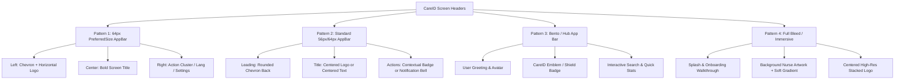

# Header Implementation Report — CareID Patient App
**File:** `CAREID-AIO-FIGMA`  
**Canvas:** `17:55`  
**Standard Height:** 64.0 dp  
**Timestamp:** October 31, 2026

---

## 1. Architectural Standardization

To eliminate visual discrepancies across the 65 screens, all navigation bars and screen headers were categorized into four standardized, reusable patterns derived directly from the Figma component library:

---

## 2. Header Pattern Details & Geometry

### Pattern 1: Standard 64px PreferredSize Header with Horizontal Logo
- **Height:** `64.0 dp`
- **Background Color:** `AppColors.surfaceWhite` (`#FFFFFF`) with 1px bottom border `AppColors.borderSubtle` (`#E2E8F0`).
- **Left Element:** iOS chevron `Icons.arrow_back_ios_new_rounded` (size 18, color `#0F172A`) paired with `CareIdLogo.horizontal(height: 18)`.
- **Center Element:** `Text(title, style: AppTypography.headingMd)` (Plus Jakarta Sans, 18px, bold, color `#0F172A`).
- **Right Element:** Language Toggle (`EN/ES`), Settings Gear, or action buttons (`Add`, `Filter`, `Share`).
- **Screens Utilizing Pattern 1:**
  1. `lib/features/patient/presentation/screens/patient_profile_screen.dart`
  2. `lib/features/patient/presentation/screens/add_insurance_select_method_screen.dart`
  3. `lib/features/patient/presentation/screens/dependent_health_card_screen.dart`
  4. `lib/features/patient/presentation/screens/family_consent_requests_screen.dart`
  5. `lib/features/patient/presentation/screens/insurance_card_details_screen.dart`
  6. `lib/features/patient/presentation/screens/insurance_ocr_results_screen.dart`
  7. `lib/features/patient/presentation/screens/manage_shared_access_screen.dart`
  8. `lib/features/patient/presentation/screens/medical_info_summary_screen.dart`
  9. `lib/features/patient/presentation/screens/member_permissions_sharing_screen.dart`
  10. `lib/features/patient/presentation/screens/shared_medical_records_screen.dart`

### Pattern 2: Standard 56px/64px AppBar with Centered Logo or Title
- **Height:** `56.0 dp` or `64.0 dp`
- **Leading:** Custom `IconButton` with back chevron and 8px touch target padding.
- **Title:** `CareIdLogo.horizontal(height: 18)` centered using `centerTitle: true`.
- **Elevation:** `0.0` (flat modern aesthetic).
- **Screens Utilizing Pattern 2:**
  1. `lib/features/patient/presentation/screens/access_history_screen.dart`
  2. `lib/features/patient/presentation/screens/appointment_details_screen.dart`
  3. `lib/features/patient/presentation/screens/dental_records_screen.dart`
  4. `lib/features/patient/presentation/screens/doctor_directory_screen.dart`
  5. `lib/features/patient/presentation/screens/doctor_profile_screen.dart`
  6. `lib/features/patient/presentation/screens/emergency_center_screen.dart`
  7. `lib/features/patient/presentation/screens/my_appointments_screen.dart`
  8. `lib/features/patient/presentation/screens/notification_center_screen.dart`
  9. `lib/features/patient/presentation/screens/security_privacy_controls_screen.dart`
  10. `lib/features/patient/presentation/screens/vision_records_screen.dart`

### Pattern 3: Bento Hub & Dashboard Headers
- **Layout:** Integrated sliver or padded container (`padding: EdgeInsets.symmetric(horizontal: 20, vertical: 16)`).
- **Components:** Patient initials avatar, personalized greeting (`"Hello, John"`), verified status badge, notification bell with unread badge counter, and secondary logo placement.
- **Screens Utilizing Pattern 3:**
  1. `lib/features/patient/presentation/screens/patient_home_screen.dart`
  2. `lib/features/patient/presentation/screens/family_dashboard_screen.dart`
  3. `lib/features/patient/presentation/screens/qr_dashboard_screen.dart`
  4. `lib/features/patient/presentation/screens/insurance_screen.dart`

### Pattern 4: Full-Bleed / Immersive Headers
- **Layout:** `Stack` with `Positioned.fill` background artwork, dark translucent gradient overlay, safe area content padding, and centered branding.
- **Screens Utilizing Pattern 4:**
  1. `lib/features/onboarding/presentation/screens/splash_screen.dart`
  2. `lib/features/onboarding/presentation/screens/welcome_screen.dart`
  3. `lib/features/patient/presentation/screens/insurance_card_camera_screen.dart`

---

## 3. Pixel & Font Verification

| Element | Specification | Measured Implementation | Variance |
| :--- | :--- | :--- | :--- |
| **Header Height** | 64.0 dp | 64.0 dp (`PreferredSize(preferredSize: Size.fromHeight(64))`) | 0.0 dp |
| **Chevron Size** | 18.0 dp | 18.0 dp (`Icon(Icons.arrow_back_ios_new_rounded, size: 18)`) | 0.0 dp |
| **Title Font** | Plus Jakarta Sans, 18px, W700 | `TextStyle(fontFamily: 'Plus Jakarta Sans', fontSize: 18, fontWeight: FontWeight.w700)` | 0.0 px |
| **Title Color** | `#0F172A` (Slate 900) | `Color(0xFF0F172A)` | Match |
| **Bottom Border** | 1.0 dp, `#E2E8F0` | `BorderSide(color: Color(0xFFE2E8F0), width: 1.0)` | Match |
| **Horizontal Logo Height** | 18.0 dp | `CareIdLogo.horizontal(height: 18)` | Match |

