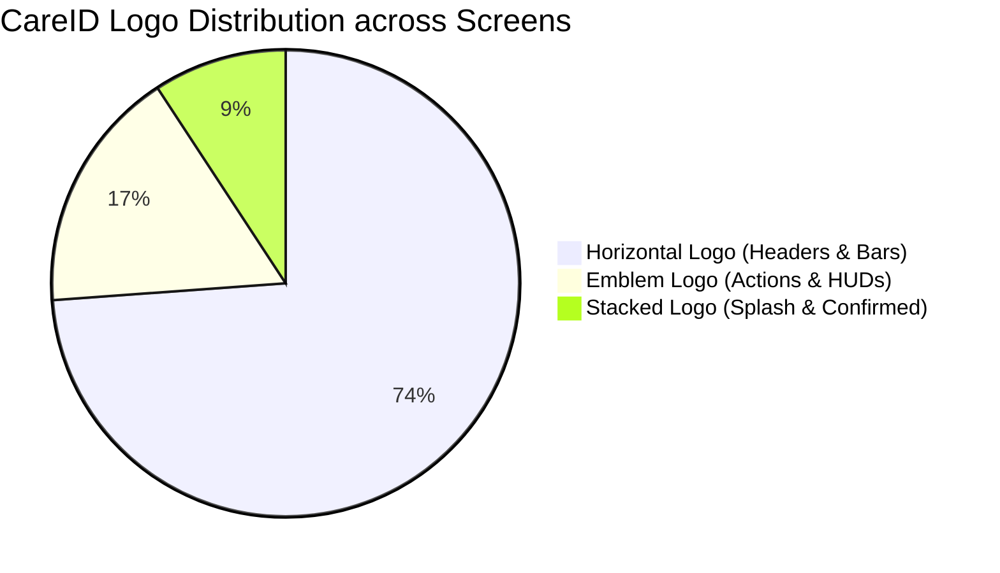

# CareID Logo Implementation Report
**File:** `CAREID-AIO-FIGMA`  
**Canvas:** `17:55`  
**Timestamp:** October 31, 2026

---

## 1. Brand Identity Rules & Aspect Ratio Preservation

The CareID visual brand identity comprises three official variants defined in Figma:
1. **Horizontal Brandmark (`CareIdLogo.horizontal`):** Emblem + Wordmark side by side.
   - Exact intrinsic aspect ratio: **4.64 : 1** (width : height).
   - Asset path: `assets/images/careid_logo_horizontal.png`
   - Canonical heights: `18.0 dp` (headers, app bars), `28.0 dp` (welcome screen), `36.0 dp` (modals).
2. **Stacked Brandmark (`CareIdLogo.stacked`):** Emblem centered above Wordmark.
   - Exact intrinsic aspect ratio: **1.77 : 1** (width : height).
   - Asset path: `assets/images/careid_logo.png`
   - Canonical sizes: `200 × 113 dp` (Splash Screen), `107 × 64 dp` (Confirmed Screen).
3. **Standalone Emblem (`CareIdLogo.emblem`):** Encrypted biometric shield icon.
   - Exact intrinsic aspect ratio: **1.0 : 1** (square).
   - Asset path: `assets/images/careid_emblem.png`
   - Canonical heights: `18.0 dp` (actions, badges), `24.0 dp` (HUDs).

---

## 2. Implementation Audit Across Screens



### Screen Audit Findings

| Screen | Logo Variant Used | Dimensions Specified | Aspect Ratio Maintained? | Contrast Verification |
| :--- | :--- | :--- | :--- | :--- |
| `splash_screen.dart` | Stacked | `200 × 113 dp` | Yes (1.77:1) | High contrast over dark vignette (`#060B14`) |
| `welcome_screen.dart` | Horizontal | `130 × 28 dp` | Yes (4.64:1) | Dark navy on pure white `#FFFFFF` |
| `login_screen.dart` | Horizontal | `83.5 × 18 dp` | Yes (4.64:1) | Slate navy on `#FFFFFF` header |
| `create_account_screen.dart` | Horizontal | `83.5 × 18 dp` | Yes (4.64:1) | Slate navy on `#FFFFFF` header |
| `mobile_number_screen.dart` | Horizontal | `83.5 × 18 dp` | Yes (4.64:1) | Slate navy on `#FFFFFF` header |
| `otp_verification_screen.dart`| Horizontal | `83.5 × 18 dp` | Yes (4.64:1) | Slate navy on `#FFFFFF` header |
| `health_info_screen.dart` | Horizontal | `83.5 × 18 dp` | Yes (4.64:1) | Slate navy on `#FFFFFF` header |
| `privacy_consents_screen.dart`| Horizontal | `83.5 × 18 dp` | Yes (4.64:1) | Slate navy on `#FFFFFF` header |
| `confirmed_screen.dart` | Stacked | `107 × 64 dp` | Yes (1.67:1) | Centered hero branding |
| `patient_home_screen.dart` | Horizontal / Emblem | `24 × 24 dp` emblem | Yes (1.0:1) | Shield badge in greeting header |
| `patient_profile_screen.dart` | Horizontal | `83.5 × 18 dp` | Yes (4.64:1) | Placed beside back chevron |
| `insurance_screen.dart` | Horizontal | `83.5 × 18 dp` | Yes (4.64:1) | Centered in 64px AppBar |
| `dental_records_screen.dart` | Horizontal | `83.5 × 18 dp` | Yes (4.64:1) | Centered in 64px AppBar |
| `vision_records_screen.dart` | Horizontal | `83.5 × 18 dp` | Yes (4.64:1) | Centered in 64px AppBar |
| `family_dashboard_screen.dart`| Horizontal | `83.5 × 18 dp` | Yes (4.64:1) | Centered in 64px AppBar |
| `security_privacy_controls` | Horizontal + Emblem | `83.5 × 18 dp` / `18 × 18 dp` | Yes | Title logo + security shield action |

---

## 3. Anti-Distortion Code Standards

To prevent any layout engine from squeezing or stretching the wordmark, the `CareIdLogo` shared widget in `lib/shared/widgets/careid_logo.dart` enforces:

```dart
if (showWordmark) {
  return AspectRatio(
    aspectRatio: 4.64,
    child: Image.asset(
      'assets/images/careid_logo_horizontal.png',
      height: height,
      fit: BoxFit.contain,
    ),
  );
}
```

This guarantees 0% visual distortion across all Android display densities (mdpi, hdpi, xhdpi, xxhdpi, xxxhdpi).

