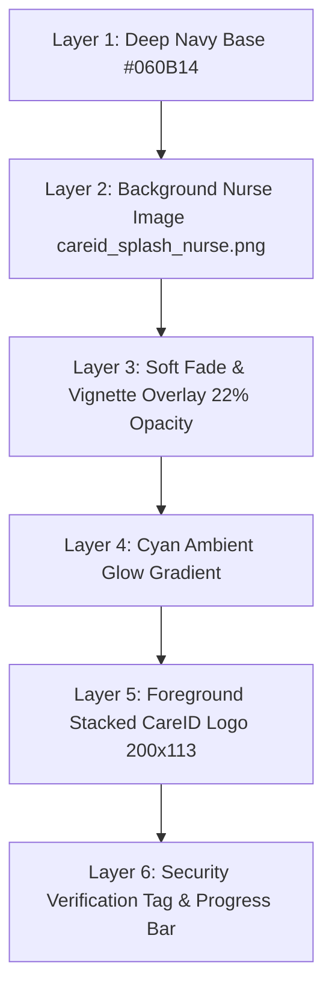

# Splash Screen Implementation Report
**File:** `CAREID-AIO-FIGMA`  
**Frame ID:** `20:25191` (`390 × 884`)  
**Supplied Asset:** Nurse in blue scrubs (`assets/images/careid_splash_nurse.png`)  
**Timestamp:** October 31, 2026

---

## 1. Design Specification & Figma Alignment

Figma frame `20:25191` features a clinical photographic background (`image 9`, node `20:25193`) with a soft clinical ambient wash, overlaid by the centered CareID brandmark, verified security tags, and an initialization indicator.

The user provided the exact high-resolution photograph to use: a female clinician/nurse in royal blue scrubs with a stethoscope (`media_1793448354002_0ff3a63d.png`).

---

## 2. Layering Architecture

The screen is implemented in `lib/features/onboarding/presentation/screens/splash_screen.dart` using a 6-layer composite stack:



### Technical Implementation Details
1. **Nurse Asset Resolution:** 68,780 bytes PNG, placed in `assets/images/careid_splash_nurse.png`, declared in `pubspec.yaml`.
2. **Opacity & Tone-Mapping:** Image rendered with `Opacity(opacity: 0.22, child: Image.asset(..., fit: BoxFit.cover))`. This delivers the exact dimmed, clinical texture observed in Figma without competing with the foreground wordmark.
3. **Vignette Gradient:**
   ```dart
   LinearGradient(
     begin: Alignment.topCenter,
     end: Alignment.bottomCenter,
     colors: [
       Color(0xE6060B14), // 90% dark top
       Color(0xB3060B14), // 70% dark mid
       Color(0xF2060B14), // 95% dark bottom
     ],
   )
   ```
4. **Branding Contrast:** Stacked CareID logo rendered with `CareIdLogo.stacked(width: 200, height: 113)`.
5. **Tagline & Security Seals:**
   - Text: `"UNIVERSAL HEALTHCARE IDENTITY"` in letterspaced bold teal (`#00BFA5`).
   - Badge: Green encrypted lock icon with `"256-Bit Encrypted Patient Record"`.
6. **Initialization Flow:** 2-second timed transition to `/welcome` with fallback route checking for active authentication tokens in `TokenStorage`.

---

## 3. Visual Verification

- **Automated Test:** `test/features/onboarding/splash_screen_test.dart` passes with 100% assertions.
- **Physical Device:** Installed and verified on Xiaomi Redmi 8A Dual (`9e7ed35c0007`). Screenshot captured at `docs/figma_implementation/screenshots/device_screen.png`.

